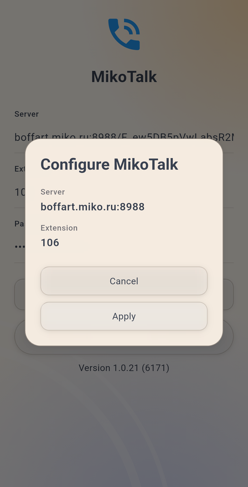
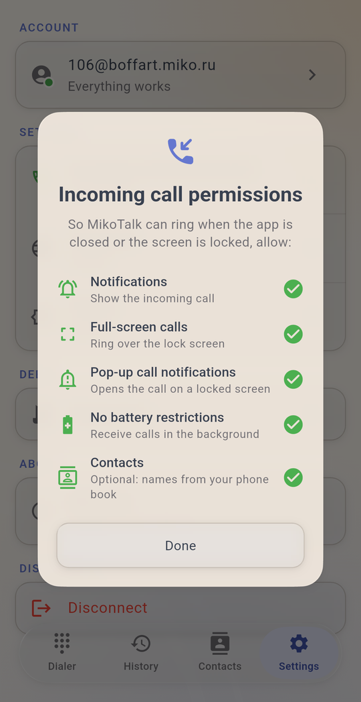
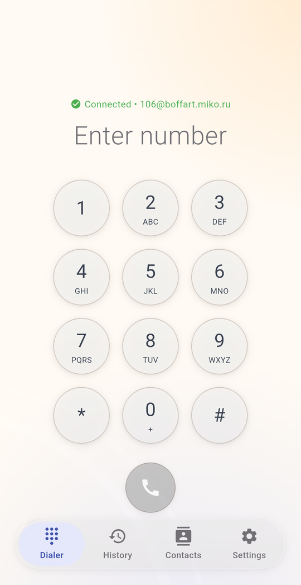
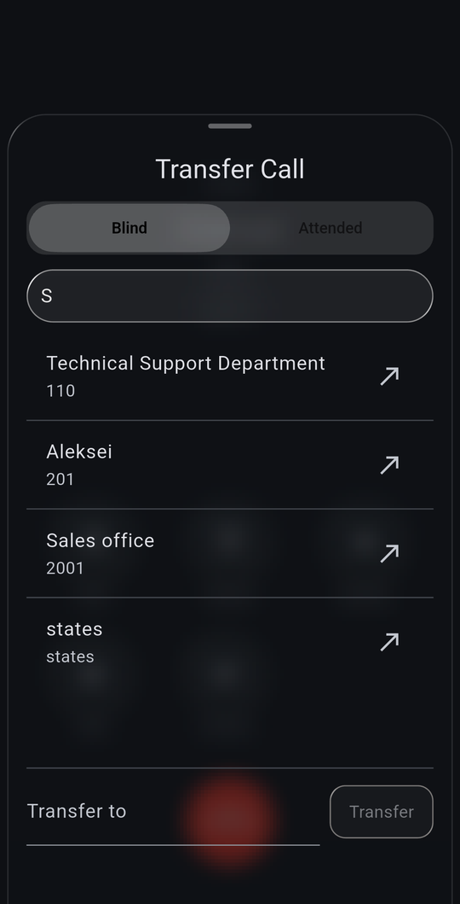
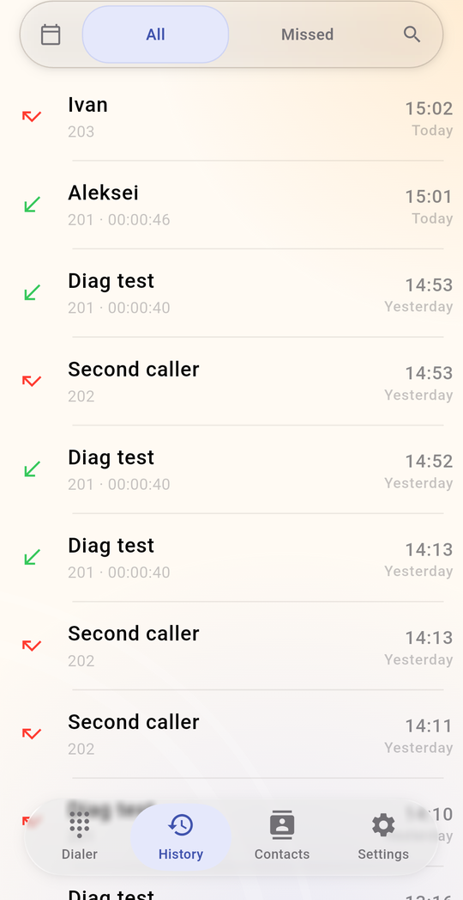
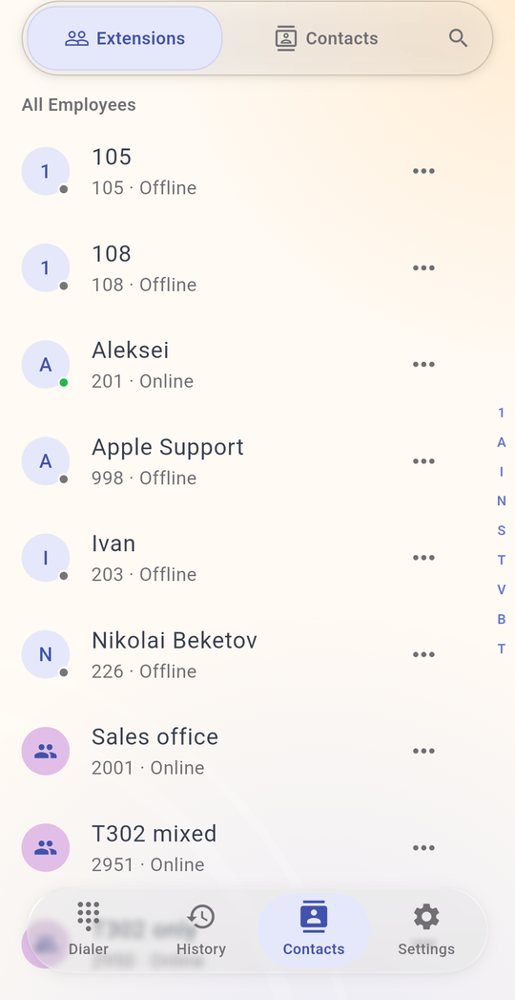
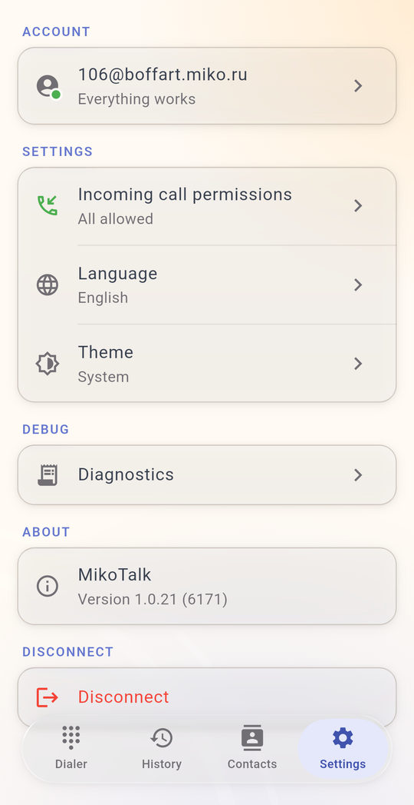
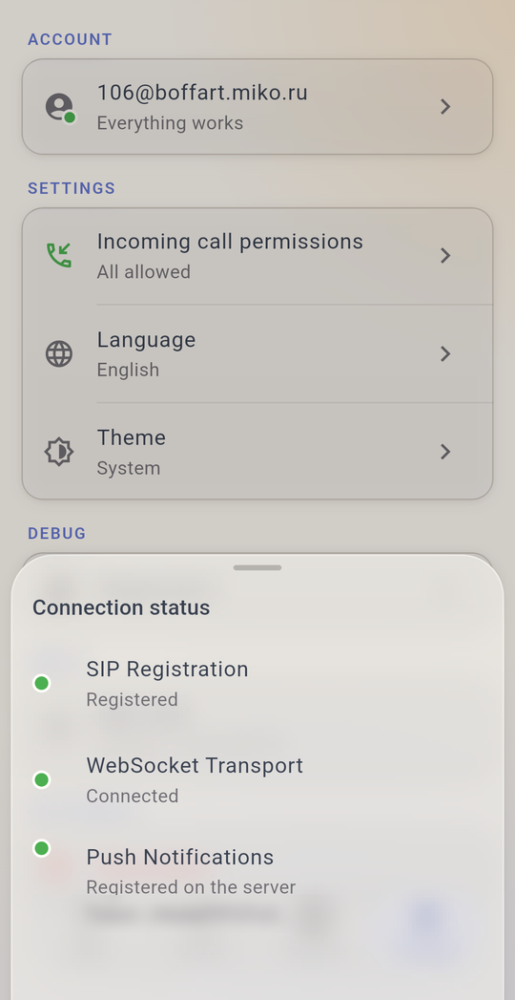

# MikoTalk for iPhone and Android

**MikoTalk** is the mobile softphone for MikoPBX. Incoming calls arrive even when the app is closed and the screen is locked, and the app shows your colleagues with their statuses and your call history. No manual SIP setup is needed: the phone connects to the PBX with a QR code or an auto-configuration link.

The app works through the [MikoTalk Push Softphone API](../../modules/miko/module-softphone-backend.md) module, which the PBX administrator installs and configures — see [Installation](../../modules/miko/module-softphone-backend.md#install).

What you need:

* an iPhone with iOS 15 or later, or an Android smartphone with Android 7.0 or later;
* a QR code or auto-configuration link for your extension — your PBX administrator provides it (on screen or by email).

## Step 1. Install the app 

Scan the QR code for your platform with the phone camera, or tap the link below it if you are reading this page on the phone itself.

| iPhone                                                                                               | Android                                                                                                  |
| ---------------------------------------------------------------------------------------------------- | -------------------------------------------------------------------------------------------------------- |
|   |  |
| [MikoTalk on the App Store](https://apps.apple.com/app/id6759347414)                                | [MikoTalk on Google Play](https://play.google.com/store/apps/details?id=ru.miko.sipsoftphone)            |

## Step 2. Connect to the PBX 

1. Scan the auto-configuration QR code with the phone camera, or open the email on the phone and tap the link. The link opens in MikoTalk.
2. Check the server and your extension and tap **Apply**.

<figure><figcaption>
Confirming auto-configuration
</figcaption></figure>

Once the green **Connected** label with your extension appears above the dial pad, the app is ready for calls.


Install the app first, then open the link. The auto-configuration link is usually one-time and valid for a limited period: if it has already been used or has expired, ask your administrator for a new one.


## Step 3. Allow incoming calls 

On first launch the app asks for permissions. Without them, calls only arrive while the app is open.



* **Notifications** — without them, incoming calls do not reach a closed app.
* **Microphone** — requested on the first call.
* **Contacts** — optional: needed to show names from your phone book.

MikoTalk incoming calls appear like regular iPhone calls, including on the lock screen.



Open **Settings → Incoming call permissions** and enable every item until each one shows a green check mark:

* **Notifications** — show the incoming call;
* **Full-screen calls** — ring over the lock screen;
* **Pop-up call notifications** — open the call on a locked screen;
* **No battery restrictions** — receive calls in the background;
* **Contacts** — optional, names from your phone book.

The app asks for the microphone (Android calls it "Record audio") on the first call.

<figure><figcaption>
Incoming call permissions on Android
</figcaption></figure>


On Xiaomi, POCO, Redmi, OnePlus and some other brands, the system additionally restricts background apps. If calls do not appear on the locked screen, allow autostart, pop-up windows and showing on the lock screen in the system settings of the MikoTalk app.




Check the setup: close the app, lock the phone and ask a colleague to call your extension. The call should arrive as a regular incoming call.

## Using the app 

The bottom of the screen has four sections: **Dialer**, **History**, **Contacts** and **Settings**.

### Dialer 

Enter a number and tap the green call button. Long-press **0** to enter **+**. You can paste a number from the clipboard by long-pressing the number field.

<figure><figcaption>
Dialer
</figcaption></figure>

### Incoming call and conversation 

An incoming call shows the caller's name and number. On an unlocked phone it appears at the top of the screen with **Answer** and **Decline** buttons; on a locked screen it opens full screen.

During a call you can use:

* **Mute** — the other party stops hearing you;
* **Keypad** — touch-tone dialing, for example for a voice menu;
* **Speaker** — speakerphone;
* **Hold** — the other party hears hold music;
* **Transfer** — transfer the call to a colleague.

<figure><figcaption>
Call screen
</figcaption></figure>

There are two kinds of transfer:

* **Blind** — the call goes straight to the selected colleague;
* **Attended** — you first talk to the colleague and then hand the caller over.

Pick a colleague from the list or enter a number in the **Transfer to** field.

<figure><figcaption>
Transferring a call
</figcaption></figure>

You can minimize a call with the Back button or the Home gesture: the call continues, and reopening MikoTalk takes you back to the call screen.

### Call history 

**History** lists your extension's calls on the PBX, including calls answered on other devices. Missed calls are marked with a red arrow and can be filtered with **Missed**. The calendar on the left switches the date, the magnifier on the right searches by name and number. Tap a call to call that number back.

<figure><figcaption>
Call history
</figcaption></figure>


Call recordings in the history are visible only to employees with the right to play recordings — it is granted to [supervisors](../../modules/miko/module-softphone-backend.md#supervisors).


### Extensions and contacts 

The **Extensions** tab lists PBX colleagues and groups with their status: **Online**, **Offline** or on a call. Which colleagues you see depends on the [access rights](../../modules/miko/module-softphone-backend.md#access) set by the administrator. Add frequently used numbers to **Favorites** from the **…** menu.

The **Contacts** tab shows your phone book, if you allowed access to contacts.

<figure><figcaption>
Extensions and their statuses
</figcaption></figure>

### Settings 

* **Account** — your extension and server. Tap it to see the connection status: SIP registration, WebSocket and push notifications. Green indicators mean everything works.
* **Incoming call permissions** — check and enable permissions (see [Step 3](#permissions)).
* **Language** and **Theme** — follow the system by default.
* **Diagnostics** — the app log, which you can export and send to your administrator.
* **Disconnect** — sign out of the account. To connect again, ask your administrator for a new auto-configuration link.

<figure><figcaption>
Settings
</figcaption></figure>

<figure><figcaption>
Connection status
</figcaption></figure>

## Troubleshooting 

| Problem                                                          | What to do                                                                                                                                                         |
| ---------------------------------------------------------------- | ------------------------------------------------------------------------------------------------------------------------------------------------------------------ |
| The auto-configuration link does not open or says it is invalid | Make sure the app is installed. The link may have been used already or expired — ask your administrator for a new one.                                           |
| No **Connected** label                                           | Check the phone's internet connection. Open **Settings → Account** and see which indicator is not green — tell your administrator.                                |
| Calls arrive only while the app is open                          | Check **Incoming call permissions** (see [Step 3](#permissions)). On Android, also check battery and autostart restrictions in the phone settings.                |
| "The softphone license is unavailable" message                   | Calls from the app work, but incoming calls do not reach a closed app. Contact your PBX administrator: licenses have run out or the PBX cannot verify the license. |
| No audio during a call                                           | Make sure the app is allowed to use the microphone. If the problem persists, tell your administrator the call time and number.                                    |
| You need to send details to your administrator                   | Open **Settings → Diagnostics**, tap **Share diagnostic log** and send the file to your administrator.                                                                      |
