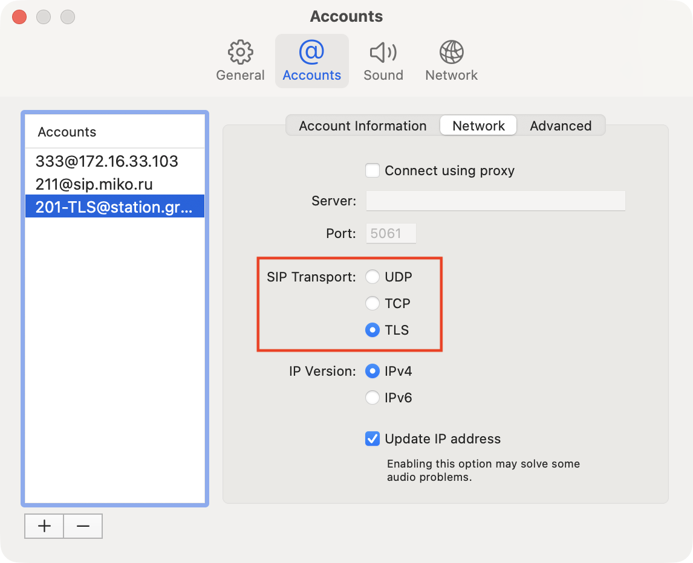
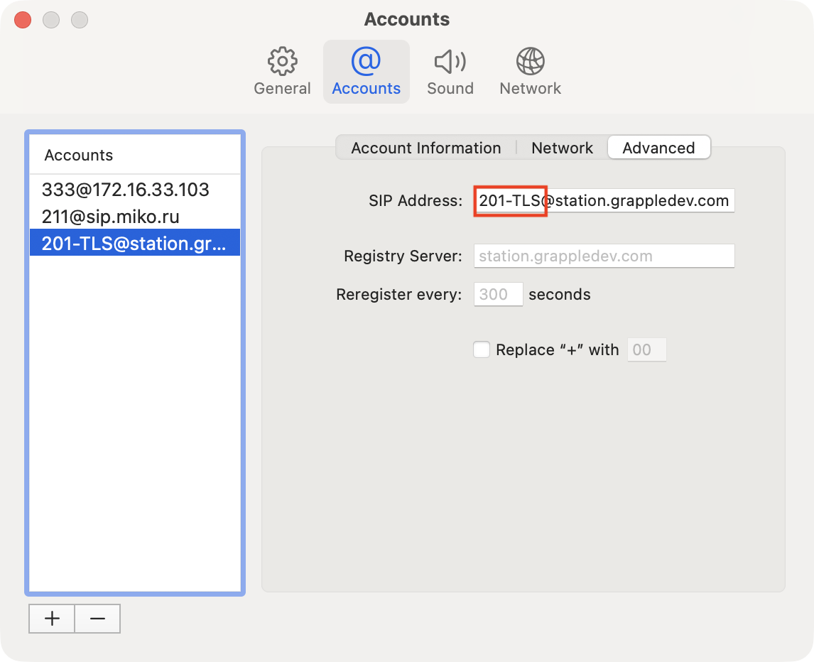

# Telephone(MacOS)

This is the simplest client for users of Apple products. You can download it from the [link](https://apps.apple.com/ru/app/telephone/id406825478?l=en\&mt=12).

1. In the "**Full Name**" field, enter the name of the employee that will be displayed in the application

<figure><figcaption></figcaption></figure>

2. In the "**Domain**" field, enter the **IP address** of the MikoPBX to which the connection is being made

<figure><figcaption></figcaption></figure>

<figure><figcaption></figcaption></figure>

3. In the "**User Name**" field, enter the internal number of the employee

<figure><figcaption></figcaption></figure>

<figure><figcaption></figcaption></figure>

4. In the "**Password**" field, enter "**SIP password**"

<figure><figcaption></figcaption></figure>

<figure><figcaption></figcaption></figure>

5. Click "**Done**"

<figure><figcaption></figcaption></figure>

The green indicator on the top indicates successful authorization. Also, the status <mark style="background-color:green;">Online</mark> should be displayed on the PBX for this internal number.

<figure><figcaption></figcaption></figure>

<figure><figcaption></figcaption></figure>

### TLS Connection

To connect via a secure TLS channel, you need to go to the Network section and select TLS as the “SIP Transport” parameter.

<figure><figcaption>
The “SIP Transport” parameter
</figcaption></figure>

Next, go to the “Network” section and add “-TLS” after the internal number.

<figure><figcaption>
The postfix “TLS” after the internal number.
</figcaption></figure>
