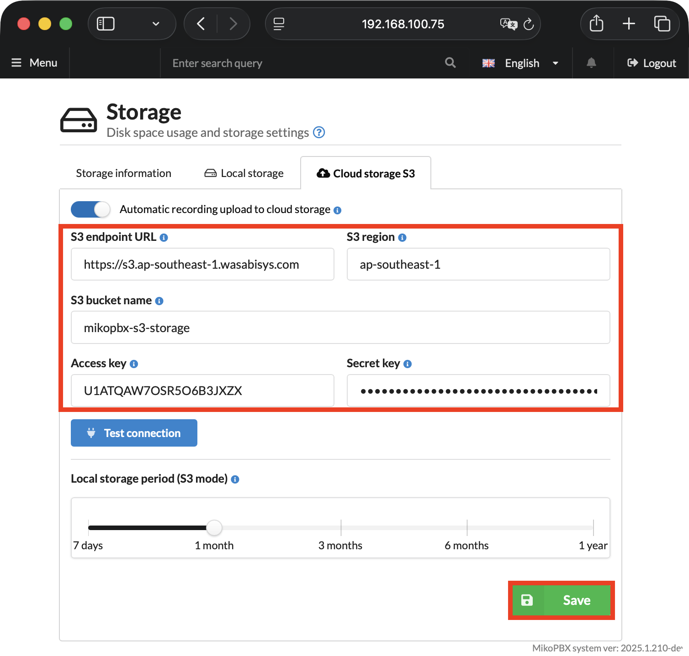

# Moving to Another S3 Bucket

This guide describes how to move call recordings from one S3 bucket to another, for example when switching cloud storage providers. Recordings are moved without stopping the station: MikoPBX keeps uploading new files, and the call history keeps access to old recordings.

### Migration steps

1. Copy the `recordings/` directory from the old bucket to the new one. You can do this with [rclone](https://rclone.org/):

```bash
rclone sync old:bucket/recordings new:bucket/recordings
```

If the old and new buckets are hosted by different providers, you can also use `aws s3 sync` and copy the data through a local machine.

2. In "**Maintenance**" -> "**Storage**", on the "**S3 Cloud Storage**" tab, enter the new bucket settings and click "**Save**".

<figure><figcaption></figcaption></figure>

3. Run the copy command from step 1 again. It copies the recordings that the station uploaded to the old bucket between the first copy and the settings switch.


MikoPBX uploads recordings to S3 every 5 minutes, so new files may reach the old bucket while you switch the settings.


4. Compare the number of objects in the old and new buckets. Then open the [call history](../../telephony/call-detail-records.md) and check that a few old recordings play back.
5. Delete the old bucket.


To be on the safe side, instead of deleting the old bucket right away, set a lifecycle rule on it that deletes objects after N days.\
\
No additional mapping between recordings and buckets is required. After the migration, retention-based deletion of recordings automatically switches to the new bucket.

