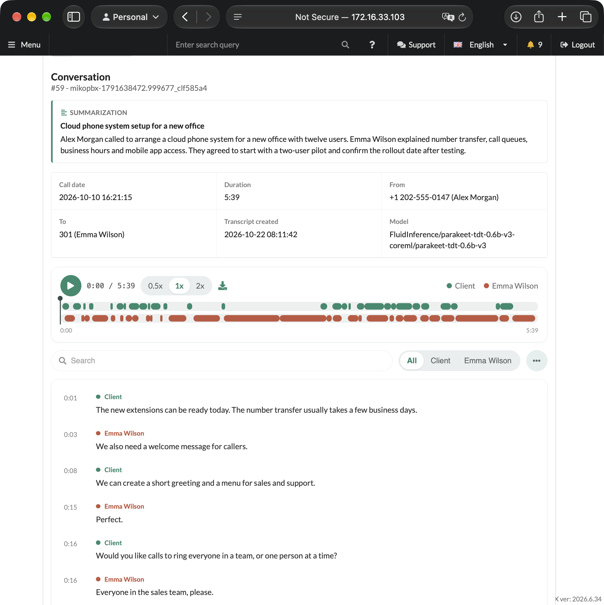
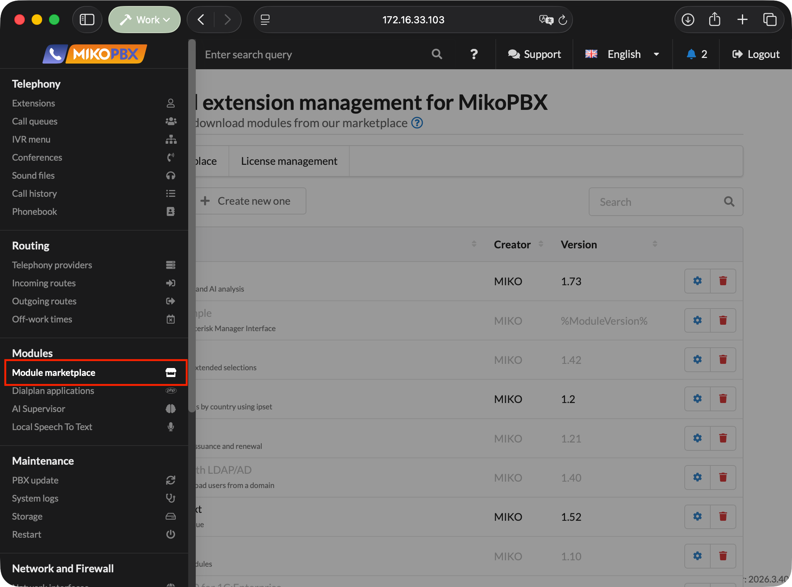
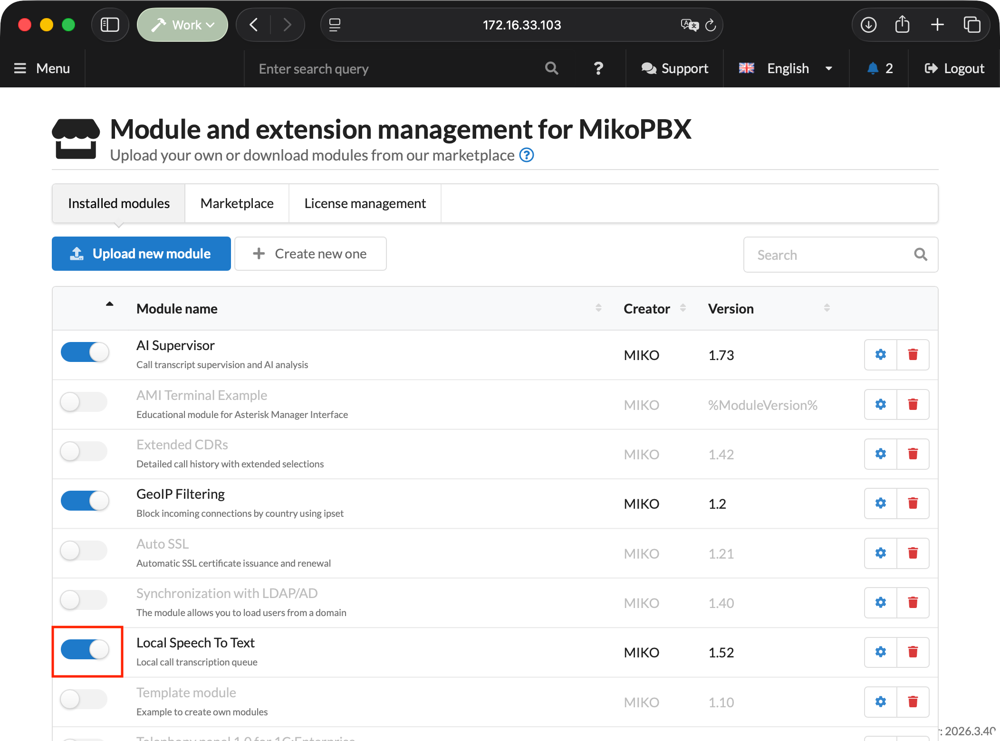
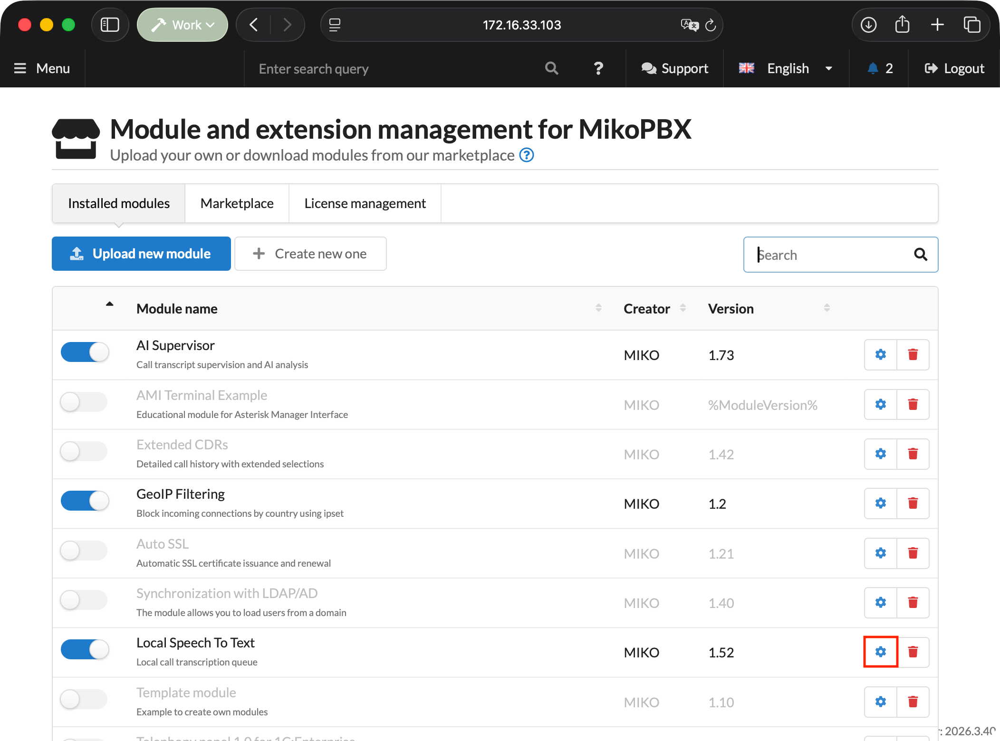
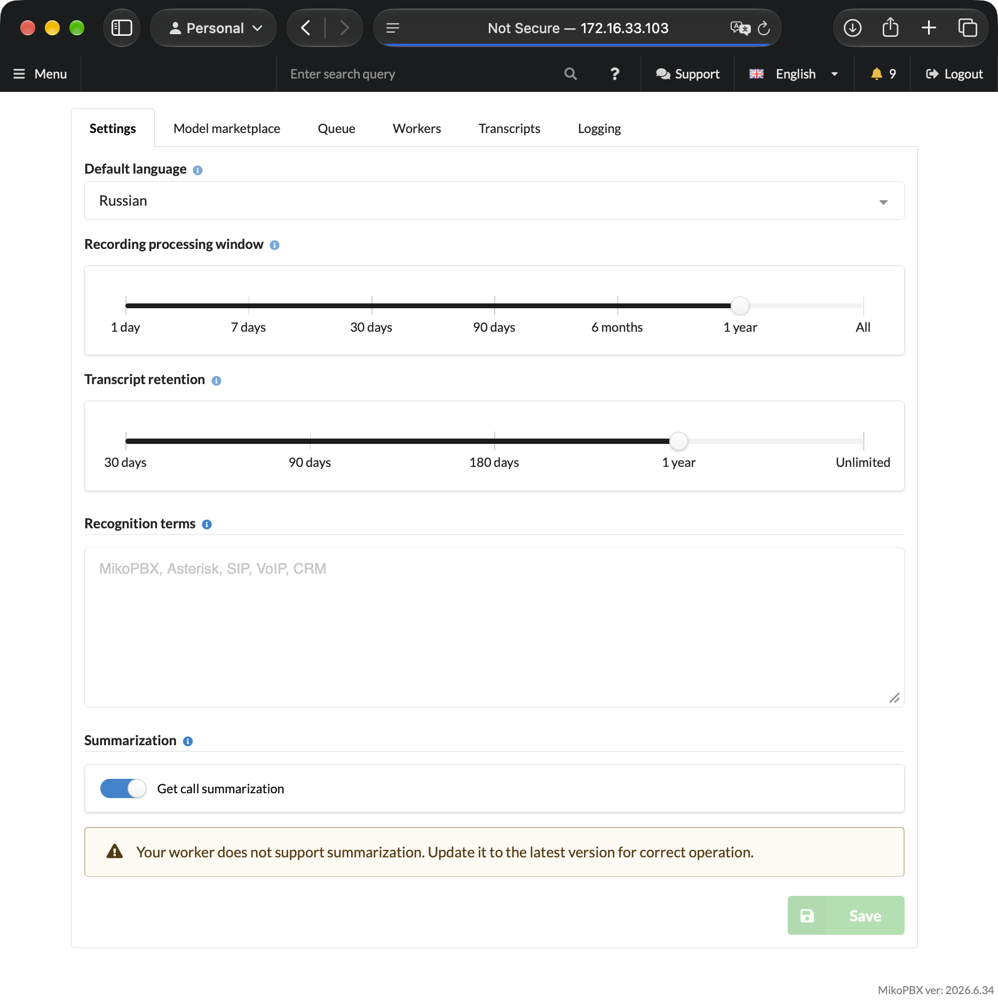
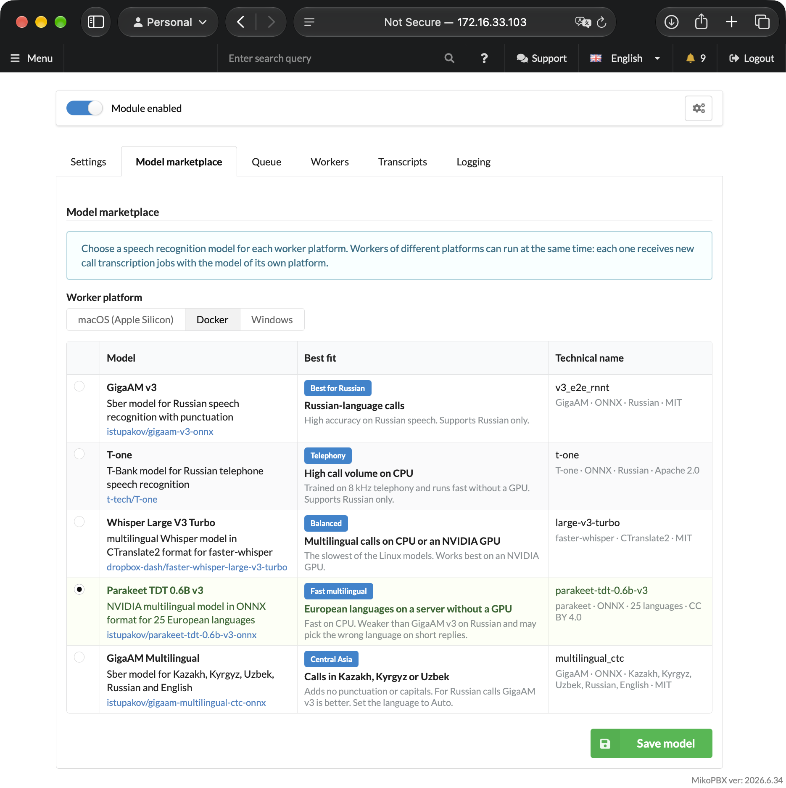
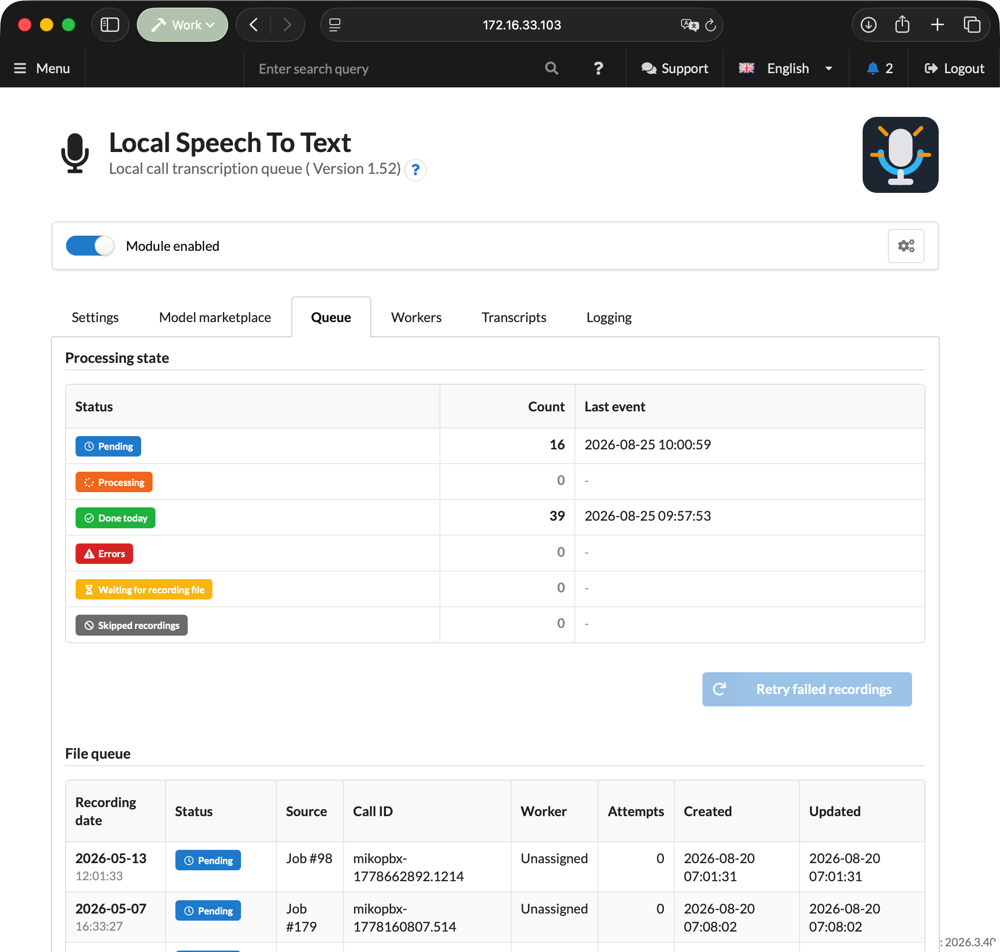
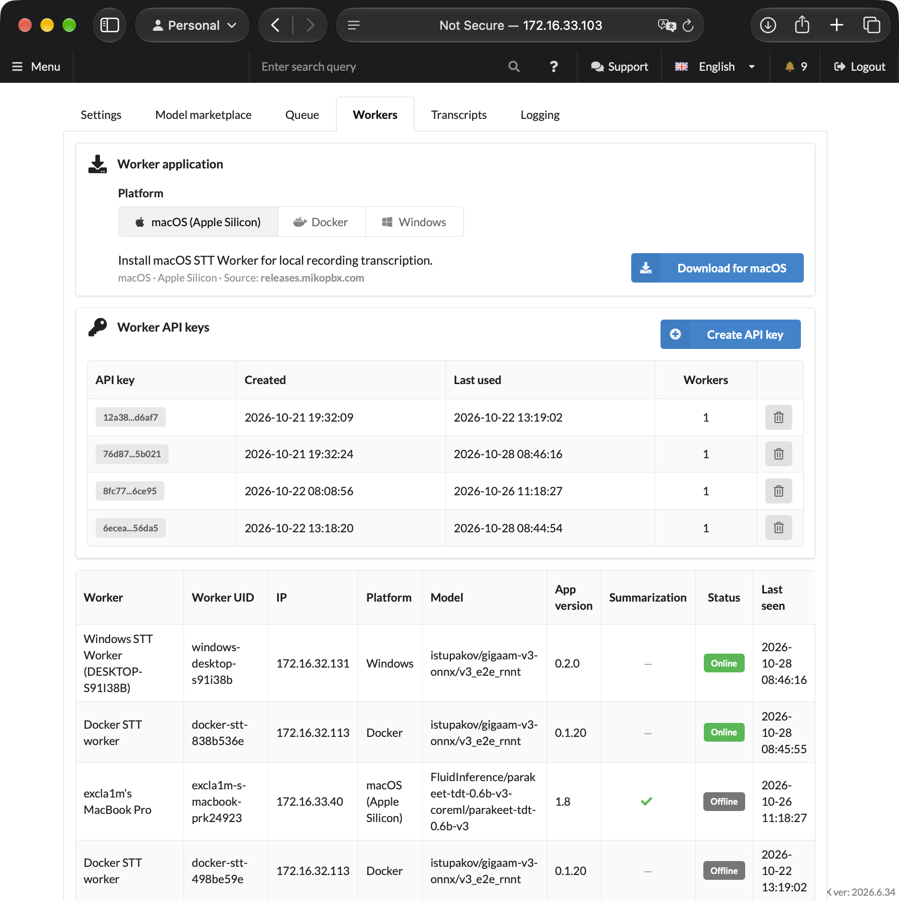
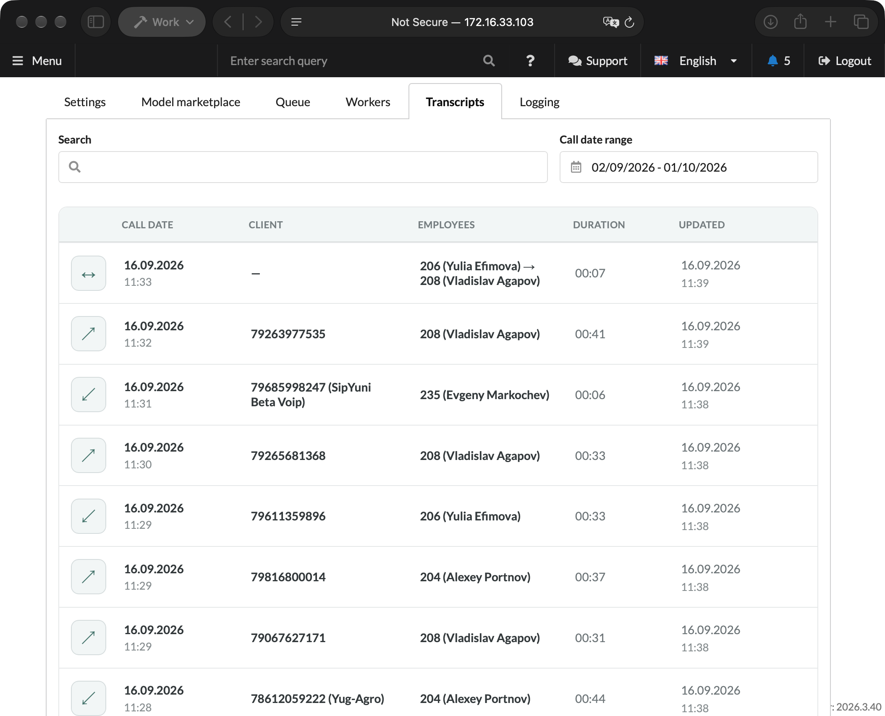
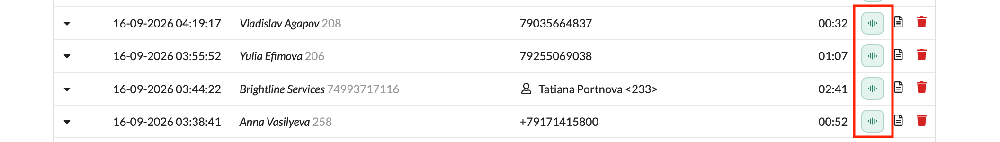

# Local Transcription

The **Local Speech To Text** module recognizes speech in recorded MikoPBX calls and saves the completed transcript as a conversation. Audio files are not sent to external cloud services: the PBX creates a job queue, while a separate **worker** downloads the assigned recording, recognizes it locally with the model selected in MikoPBX, and returns the result to MikoPBX.

Optionally, the worker also writes a **summary** of every call: its topic and a short description of the conversation. This also runs locally, on the same worker.


The PBX module runs inside MikoPBX, while recognition runs on a worker on a separate computer or server. There are three kinds of workers: an application for Mac, a Docker container, and a Windows service. See **Worker types** below for a comparison.


<figure><figcaption>
Example of transcription result
</figcaption></figure>

### Worker types

|                    | **Local STT Worker for macOS**                                        | **Docker worker**                                                                                        | **Windows worker**                                                     |
| ------------------ | --------------------------------------------------------------------- | -------------------------------------------------------------------------------------------------------- | ---------------------------------------------------------------------- |
| Where it runs      | Mac with Apple silicon (M1 or newer), macOS 14 or later               | Linux server or Mac with Docker, x86\_64 or arm64                                                        | Windows 10/11 or Windows Server 2019 or later, x64                     |
| How it is installed | Application, the **Download for macOS** button on the **Workers** tab | Image [`excla1m/mikopbx-stt-worker`](https://hub.docker.com/r/excla1m/mikopbx-stt-worker) from Docker Hub | Windows service, the **Download for Windows** button on the **Workers** tab |
| Models             | Parakeet and Whisper on Core ML with Apple acceleration               | GigaAM v3, GigaAM Multilingual, T-one, Parakeet and Whisper Turbo on the CPU                             | GigaAM v3, GigaAM Multilingual, Parakeet and Whisper Turbo on the CPU  |
| When to choose it  | You have a spare Mac; you need Whisper with hardware acceleration     | You have a Linux server or virtual machine; most calls are in Russian                                    | You have a spare Windows computer or server                            |
| Details            | [Local STT Worker](miko-ai-worker.md)                                 | [Docker worker (Linux)](docker-worker.md)                                                                | [Windows worker](windows-worker.md)                                    |

Workers of different kinds can be connected at the same time. Each platform has its own model selected on the **Model marketplace** tab, and each worker receives jobs with the model of its own platform. For example, a Docker worker can transcribe calls with GigaAM v3 while a Mac transcribes other calls with Whisper.

### How processing works

1. A call ends, and MikoPBX saves the call recording.
2. The module's background process finds the recording and creates a job.
3. A free worker takes the job from the queue.
4. The PBX provides the assigned recording file to that worker.
5. The worker prepares the audio, recognizes the speech with the model of its platform, and sends the transcript segments back.
6. The module filters the result, saves the transcript, and publishes an event for integrations.
7. If summarization is on, the worker writes a short summary of the call whenever it has no recordings to transcribe.

If a worker stops responding while processing a job, the job returns to the queue. Each job gets up to three attempts, after which it moves to the **Errors** status.

### Requirements and compatibility

* MikoPBX **2025.1.1** or later.
* A worker of one of the kinds:
  * **macOS:** Mac with Apple silicon, macOS **14.0** or later, 8 GB of memory or more, about 5 GB of disk space for models;
  * **Docker:** Linux server or Mac with Docker 20.10 or later, x86\_64 or arm64, 4 cores or more, 8 GB of memory or more, about 10 GB of disk space for the image and models;
  * **Windows:** Windows 10/11 or Windows Server 2019 or later, x64, 8 GB of memory or more, the [Visual C++ 2015-2022 x64 runtime](https://aka.ms/vs/17/release/vc_redist.x64.exe).
* For summarization, about **4 GB** of additional RAM and **3 GB** of additional disk space on the worker.
* Call recording enabled for the required routes, queues, or extensions.
* Network access from the worker to the MikoPBX web interface. Open the web interface over HTTPS: over HTTP, a newly created access key is not displayed.
* Internet access for the first download of the selected model and its supporting files. After the model has been downloaded, the worker only needs access to the PBX for processing.

### Installing the module

1. Open the MikoPBX web interface.
2. Go to **Modules** → **Module marketplace**.

<figure><figcaption>
Module marketplace
</figcaption></figure>

3. Find **Local Speech To Text** and install it.
4. Open the **Installed modules** tab and enable the module.

<figure><figcaption>
Enabling the module
</figcaption></figure>

5. Click the settings button to the right of the module version.

<figure><figcaption>
Opening the module page
</figcaption></figure>

### Settings tab

| Setting                         | Default                     | Purpose                                                                                                                |
| ------------------------------- | --------------------------- | ---------------------------------------------------------------------------------------------------------------------- |
| **Default language**            | Auto - detect automatically | Language hint for the recognition model. In automatic mode, the call language is detected during recognition.          |
| **Recording processing window** | `30 days`                   | How far back to search for completed calls with recordings: 1, 7, 30, or 90 days, 6 months, 1 year, or all recordings. |
| **Transcript retention**        | `1 year`                    | When transcription results are deleted: after 30, 90, or 180 days, 1 year, or unlimited.                               |
| **Recognition terms**           | Empty                       | Company, product, and system names, plus other words used as recognition hints.                                        |
| **Get call summarization**      | Off                         | Write the topic and a short summary of every new call. See **Summarization** below.                                    |

The recording processing window cannot exceed the transcript retention period: on a conflict, the module shows a warning and does not let you save the settings. Retention starts when recognition completes; CDR records and source audio recordings are not deleted.

The **Default language** list contains only the languages supported by the models selected on the **Model marketplace** tab. If you selected models for several platforms, the list keeps only the languages all of those models support. A platform whose model was never changed does not restrict the list.


Changing the recording processing window resets the scan cursor so that the module reviews call history within the new range.


<figure><figcaption>
Module settings
</figcaption></figure>

#### Summarization

When **Get call summarization** is on, the worker writes a **topic** and a one- or two-sentence **summary** for each call after transcribing it. Summarization runs on your worker with the **Gemma 3 4B** model; the conversation is not sent anywhere.

* There is one summary for the whole call. If the call was transferred, all parts of the conversation go into it.
* Transcription always comes first: the worker summarizes only when there are no recordings waiting to be transcribed.
* The worker downloads the model when the feature is first turned on; transcription keeps working meanwhile.
* The worker needs about **4 GB** of additional RAM and **3 GB** of additional disk space.
* Only calls transcribed after the setting was turned on get a summary.

Summarization is supported by the latest worker versions; such workers have a mark in the **Summarization** column on the **Workers** tab. If the setting is on but no connected worker supports it, the module shows a warning: update the worker to the latest version.

### Model marketplace tab

This tab selects, for each worker platform, the model that the PBX includes in new jobs. Workers of different platforms run at the same time, and each one receives jobs with the model of its own platform.

The **Worker platform** switch above the list shows the models of the selected platform. Model descriptions, supported languages, and recommendations are in the **Models** section of the worker article:

* **macOS (Apple Silicon)** - Parakeet and Whisper on Core ML: [Local STT Worker](miko-ai-worker.md);
* **Docker** - GigaAM, T-one, Parakeet and Whisper on the CPU: [Docker worker (Linux)](docker-worker.md);
* **Windows** - GigaAM, Parakeet and Whisper on the CPU: [Windows worker](windows-worker.md).

Select a model for the platform you need and click **Save model**. If the default language on the **Settings** tab is not supported by the selected model, the module shows a warning: choose **Auto - detect automatically** or a supported language.

<figure><figcaption>
Selecting a recognition model
</figcaption></figure>

### Queue tab

The **Processing state** block shows the number of recordings in each status and the time of the last event.

| Status                         | Meaning                                                                 |
| ------------------------------ | ----------------------------------------------------------------------- |
| **Pending**                    | The job is waiting for an available worker.                             |
| **Processing**                 | One of the workers is processing the job.                               |
| **Done today**                 | Jobs completed during the current day.                                  |
| **Errors**                     | Failed jobs that can be returned to the queue.                          |
| **Waiting for recording file** | A CDR record was found, but the file has not appeared or is unreadable. |
| **Skipped recordings**         | Recordings that will not be processed unless the conditions change.     |

The **Retry failed recordings** button returns all jobs in the **Errors** status to the queue.

The **File queue** table below lists the jobs themselves: recording date, status, source, call ID, worker, attempts, and the time the job was created and last updated. Newer calls are processed first.

<figure><figcaption>
Queue in the module interface
</figcaption></figure>

### Workers tab

Use this tab to download a worker, create access keys, and view connected workers.

#### Worker application

The **Platform** switch at the top of the tab selects the kind of worker:

* **macOS (Apple Silicon)** - the **Download for macOS** button downloads Local STT Worker from `releases.mikopbx.com`.
* **Docker** - a ready-made `docker pull` and `docker run` command with the address of this PBX is shown. A newly created access key is inserted into the command right away; copy the command and run it on a server with Docker. For permanent operation with `compose.yaml`, see [Docker worker (Linux)](docker-worker.md).
* **Windows** - the **Download for Windows** button opens a menu with two packages: **MSI** (an installer that registers the Windows service by itself) and **ZIP** (an archive for manual installation). Each package shows its file name and size. Below are the `setup`, `install`, and `status` commands to run in an administrator command prompt. See [Windows worker](windows-worker.md).

#### Worker API keys

The **Create API key** button generates a new key. It is shown only once after it is created, so copy it immediately.

A single key cannot be bound to multiple `worker_uid` values at the same time; create a separate key for each worker.

#### Connected workers

The worker table shows the name, UID, IP address, platform, model, application version, summarization support, status, and last activity. An incompatible worker appears offline.

Until the first worker is connected, a three-step **How to connect a worker** hint is displayed above the table on the **macOS (Apple Silicon)** platform.

<figure><figcaption>
Workers tab
</figcaption></figure>

### Transcripts tab

You can filter the list by call date range and search the transcript text. Clicking a row opens the conversation.

<figure><figcaption>
Transcript list
</figcaption></figure>

#### Transcript card

The recording player is at the top of the card: switch the playback speed between **0.5x**, **1x**, and **2x**, or save the audio file with **Download recording**. Clicking a turn or the timeline moves the player to the corresponding point in the recording.

If the employee consulted a colleague during the call, the conversation is split into the **Customer conversation** and **Internal consultation** tabs.

When summarization is on, a **Summarization** block with the call topic and summary is shown above the conversation. If the summary is not ready yet, the conversation is too short, or the call was transcribed before the setting was turned on, the block shows a message saying so.

The actions menu offers **Download TXT**, **Download JSON**, and **Delete transcript**. Deletion requires confirmation: the transcript and related module data are removed, while the MikoPBX CDR record and the source call recording are kept.

<figure><figcaption>
Transcript conversation view
</figcaption></figure>

### Transcript in call history

The module adds a **Show transcript** button to the MikoPBX **Call Detail Records** section for calls with a completed transcript. It opens the **Call transcript** window with the same player, **Summarization** block, and actions menu as the transcript card.

<figure><figcaption>
Button to open the transcript from the CDR log
</figcaption></figure>

### Logging tab

The log contains structured technical events from the module and workers, without transcripts, audio recordings, or secrets.

### Access rights

When the user access management module (ModuleUsersUI) is used, separate permissions are available for Local Speech To Text:

| Permission                                        | What it opens                                                                           |
| ------------------------------------------------- | --------------------------------------------------------------------------------------- |
| **View transcripts and call recordings**          | The **Transcripts** tab, conversation view, export, and the transcript in call history. |
| **Delete transcripts**                            | The **Delete transcript** action in the conversation view.                              |
| **Manage module settings**                        | The **Settings** and **Model marketplace** tabs.                                        |
| **Connect workers and manage the queue and logs** | The **Queue**, **Workers**, and **Logging** tabs.                                       |

Tabs the user has no permission for are not displayed. These permissions do not grant access to the module's REST API.
