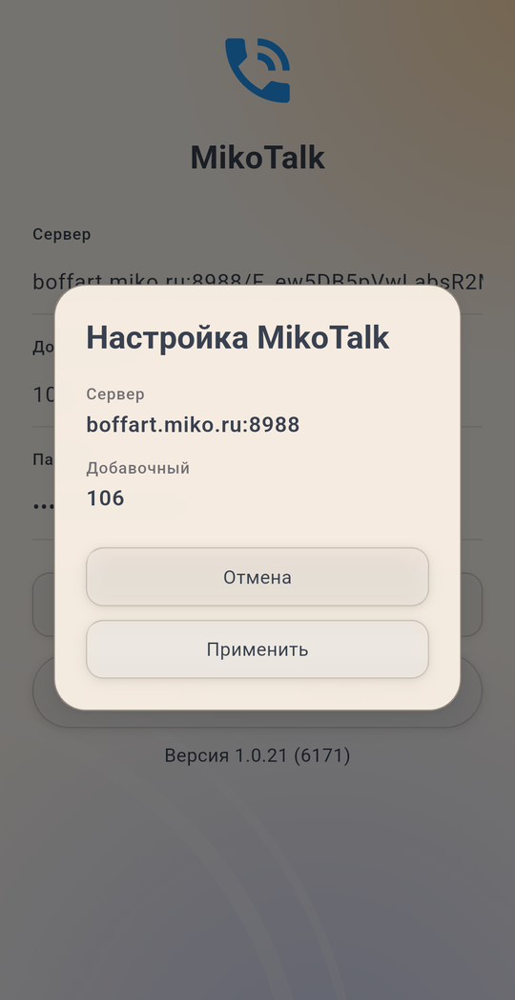
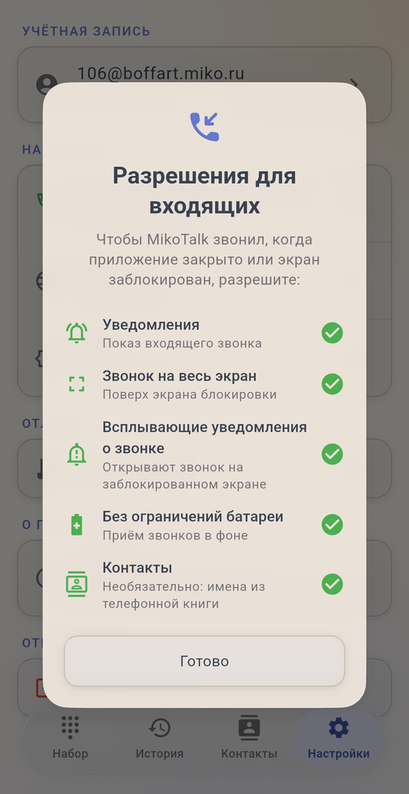
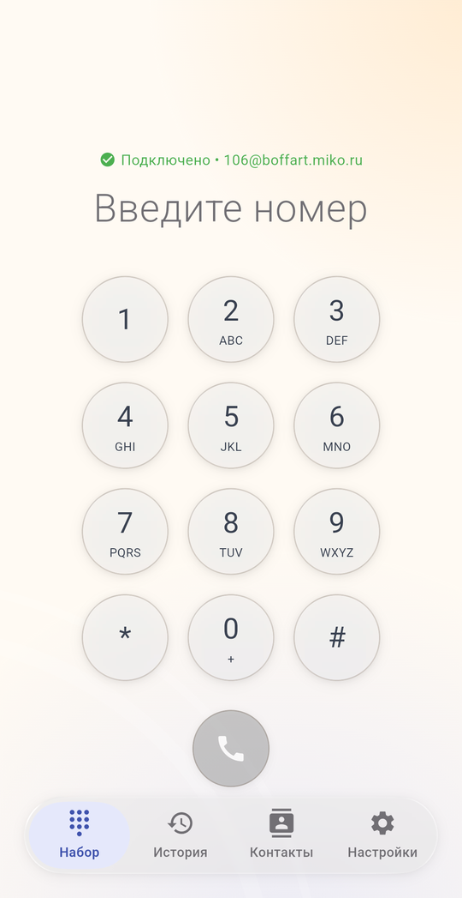
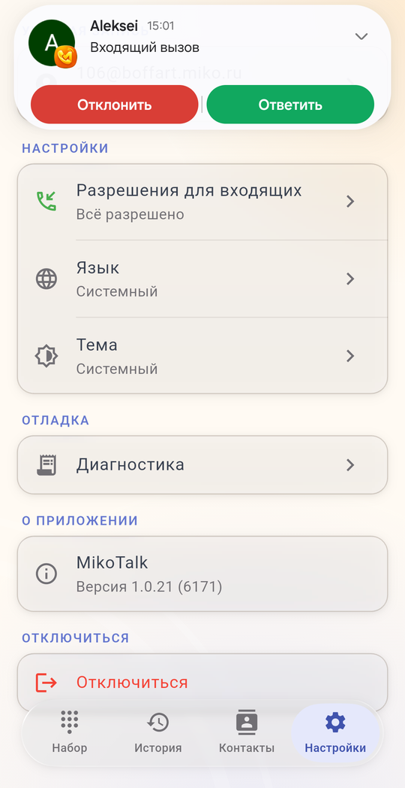
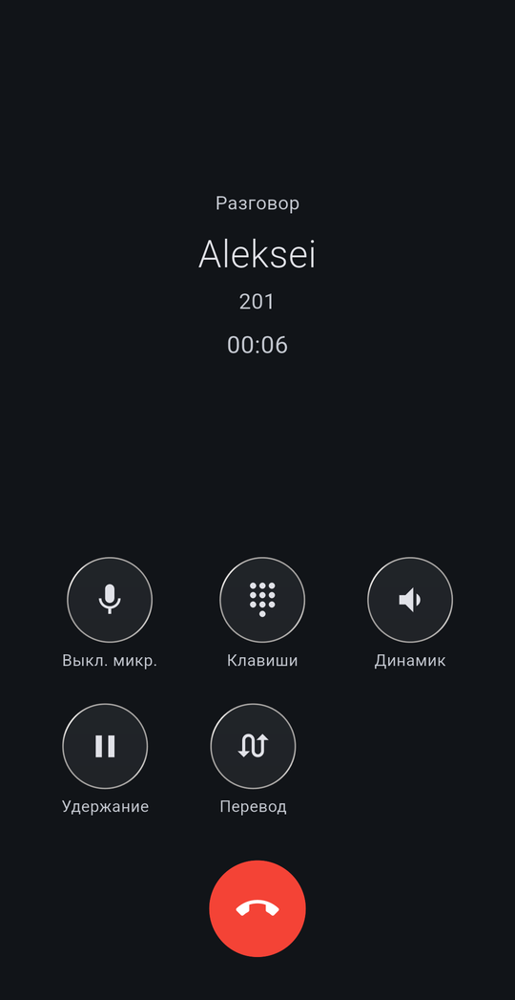
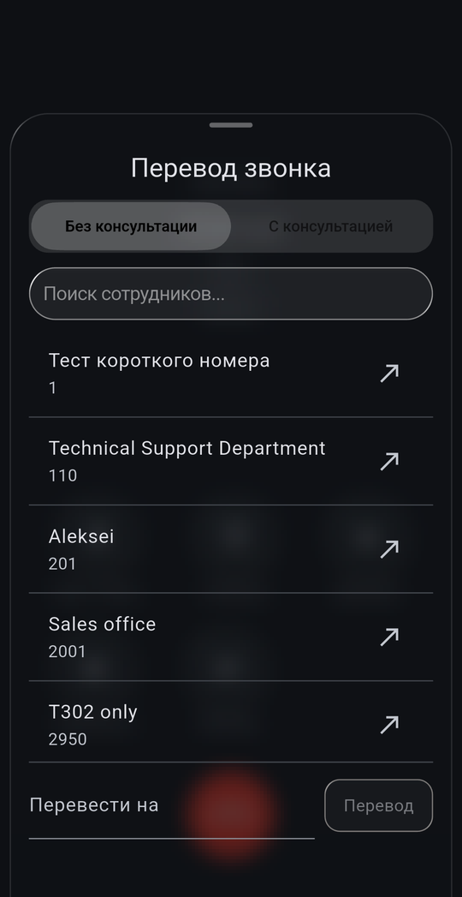
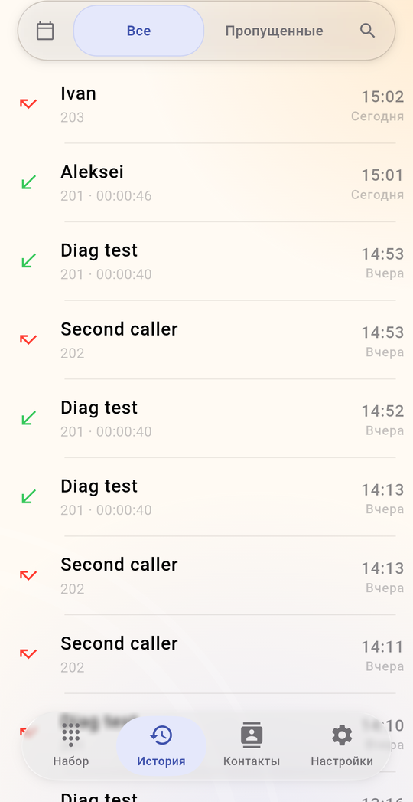
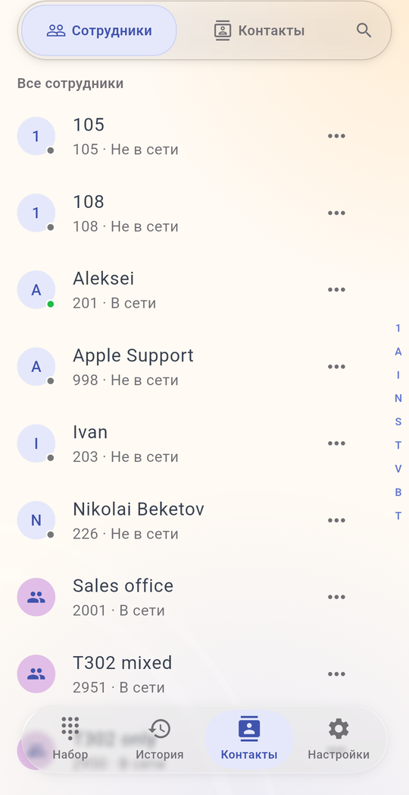
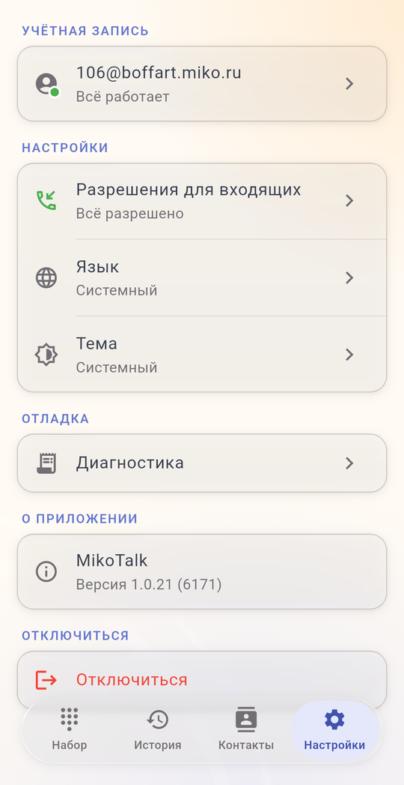
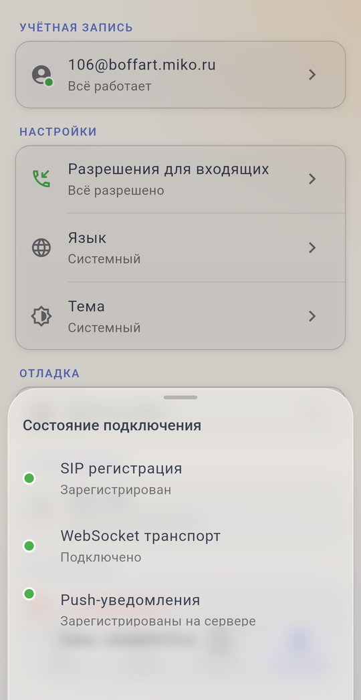

# MikoTalk для iPhone и Android

**MikoTalk** — мобильный софтфон для MikoPBX. Входящие звонки приходят даже при закрытом приложении и заблокированном экране, в приложении видны сотрудники с их статусами и история звонков. Настраивать SIP вручную не нужно: телефон подключается к АТС по QR-коду или ссылке автонастройки.

Приложение работает через модуль [MikoTalk: API для push софтфона](../../modules/miko/softfon-mikotalk.md). Модуль устанавливает и настраивает администратор АТС — см. раздел [Установка](../../modules/miko/softfon-mikotalk.md#install).

Что понадобится:

* iPhone с iOS 15 или новее либо смартфон с Android 7.0 или новее;
* QR-код или ссылка автонастройки для вашего внутреннего номера — её выдаёт администратор АТС (на экране или письмом на email).

## Шаг 1. Установите приложение 

Отсканируйте камерой телефона QR-код для своей платформы или откройте ссылку под ним, если читаете эту страницу на самом телефоне.

| iPhone                                                                                                       | Android                                                                                                            |
| ------------------------------------------------------------------------------------------------------------ | ------------------------------------------------------------------------------------------------------------------ |
|  |  |
| [MikoTalk в App Store](https://apps.apple.com/app/id6759347414)                                              | [MikoTalk в Google Play](https://play.google.com/store/apps/details?id=ru.miko.sipsoftphone)                       |

## Шаг 2. Подключитесь к АТС 

1. Отсканируйте QR-код автонастройки камерой телефона или откройте на телефоне письмо и нажмите ссылку в нём. Ссылка откроется в MikoTalk.
2. Проверьте сервер и свой внутренний номер и нажмите **«Применить»**.

<figure><figcaption>
Подтверждение автонастройки
</figcaption></figure>

Когда над номеронабирателем появится зелёная надпись **«Подключено»** с вашим номером, приложение готово к звонкам.


Сначала установите приложение, потом открывайте ссылку. Ссылка автонастройки обычно одноразовая и действует ограниченное время: если она уже использована или устарела, попросите у администратора новую.


## Шаг 3. Разрешите входящие звонки 

При первом запуске приложение запросит разрешения. Без них звонки будут приходить только при открытом приложении.



* **Уведомления** — без них входящие звонки на закрытое приложение не приходят.
* **Микрофон** — запрашивается при первом звонке.
* **Контакты** — необязательно: нужны, чтобы видеть имена из телефонной книги.

Входящие звонки MikoTalk показываются как обычные звонки iPhone, в том числе на заблокированном экране.



Откройте **«Настройки» → «Разрешения для входящих»** и включите все пункты, пока напротив каждого не появится зелёная галочка:

* **Уведомления** — показ входящего звонка;
* **Звонок на весь экран** — окно входящего поверх экрана блокировки;
* **Всплывающие уведомления о звонке** — открывают звонок на заблокированном экране;
* **Без ограничений батареи** — приём звонков, когда приложение в фоне;
* **Контакты** — необязательно, имена из телефонной книги.

Микрофон (в Android он называется «Запись аудио») приложение запросит при первом звонке.

<figure><figcaption>
Разрешения для входящих на Android
</figcaption></figure>


На смартфонах Xiaomi, POCO, Redmi, OnePlus и некоторых других производителей система дополнительно ограничивает фоновые приложения. Если звонки не приходят на заблокированный экран, в системных настройках приложения MikoTalk разрешите автозапуск, всплывающие окна и показ на экране блокировки.




Проверьте настройку: закройте приложение, заблокируйте телефон и попросите коллегу позвонить на ваш внутренний номер. Звонок должен прийти как обычный входящий.

## Работа с приложением 

Внизу экрана четыре раздела: **«Набор»**, **«История»**, **«Контакты»** и **«Настройки»**.

### Набор номера 

Наберите номер и нажмите зелёную кнопку вызова. Долгое нажатие на **0** вводит **+**. Номер можно вставить из буфера обмена долгим нажатием на поле номера.

<figure><figcaption>
Номеронабиратель
</figcaption></figure>

### Входящий звонок и разговор 

Входящий звонок показывается с именем и номером звонящего. Если телефон разблокирован, он появляется вверху экрана с кнопками **«Ответить»** и **«Отклонить»**. На заблокированном экране он открывается на весь экран.

<figure><figcaption>
Входящий звонок на разблокированном телефоне
</figcaption></figure>

Во время разговора доступны:

* **Выкл. микр.** — собеседник перестаёт вас слышать;
* **Клавиши** — тональный набор, например для голосового меню;
* **Динамик** — громкая связь;
* **Удержание** — собеседник слышит музыку ожидания;
* **Перевод** — перевод звонка другому сотруднику.

<figure><figcaption>
Экран разговора
</figcaption></figure>

Перевод бывает двух видов:

* **Без консультации** — звонок сразу уходит выбранному сотруднику;
* **С консультацией** — сначала вы разговариваете с сотрудником, а затем переводите на него собеседника.

Сотрудника выберите из списка или введите номер в поле **«Перевести на»**.

<figure><figcaption>
Перевод звонка
</figcaption></figure>

Разговор можно свернуть кнопкой «Назад» или жестом «Домой»: звонок продолжится, а при повторном открытии MikoTalk вы вернётесь на экран разговора.

### История звонков 

В разделе **«История»** собраны звонки вашего номера на АТС, в том числе принятые на других устройствах. Пропущенные отмечены красной стрелкой, и их можно отфильтровать кнопкой **«Пропущенные»**. Календарь слева переключает дату, лупа справа ищет по имени и номеру. Нажмите на звонок, чтобы перезвонить на этот номер.

<figure><figcaption>
История звонков
</figcaption></figure>


Записи разговоров в истории видят только сотрудники с правом прослушивания записей — его выдают [супервизорам](../../modules/miko/softfon-mikotalk.md#supervisors).


### Сотрудники и контакты 

На вкладке **«Сотрудники»** — коллеги и группы АТС со статусами: **«В сети»**, **«Не в сети»**, разговаривает. Какие сотрудники видны, зависит от [прав доступа](../../modules/miko/softfon-mikotalk.md#access), настроенных администратором. Частые номера можно добавить в **«Избранное»** через меню **«…»**.

На вкладке **«Контакты»** — телефонная книга смартфона, если вы разрешили доступ к контактам.

<figure><figcaption>
Сотрудники и их статусы
</figcaption></figure>

### Настройки 

* **Учётная запись** — номер и сервер. Нажмите, чтобы увидеть состояние подключения: SIP-регистрация, WebSocket и push-уведомления. Зелёные индикаторы означают, что всё работает.
* **Разрешения для входящих** — проверка и включение разрешений (см. [Шаг 3](mikotalk-mobile.md#permissions)).
* **Язык** и **Тема** — по умолчанию как в системе.
* **Диагностика** — журнал работы приложения, который можно экспортировать и отправить администратору.
* **Отключиться** — выход из учётной записи. Чтобы подключиться снова, попросите у администратора новую ссылку автонастройки.

<figure><figcaption>
Настройки
</figcaption></figure>

<figure><figcaption>
Состояние подключения
</figcaption></figure>

## Если что-то не работает 

| Проблема                                                           | Что сделать                                                                                                                                                                |
| ------------------------------------------------------------------ | -------------------------------------------------------------------------------------------------------------------------------------------------------------------------- |
| Ссылка автонастройки не открывается или пишет, что недействительна | Убедитесь, что приложение установлено. Ссылка могла быть уже использована или устареть — попросите у администратора новую.                                                 |
| Нет надписи «Подключено»                                           | Проверьте интернет на телефоне. Откройте **«Настройки» → «Учётная запись»** и посмотрите, какой индикатор не зелёный, — сообщите это администратору.                       |
| Звонки приходят только при открытом приложении                     | Проверьте **«Разрешения для входящих»** (см. [Шаг 3](mikotalk-mobile.md#permissions)). На Android также проверьте ограничения батареи и автозапуска в настройках телефона. |
| Сообщение «Лицензия софтфона недоступна»                           | Звонки из приложения работают, но входящие на закрытое приложение не приходят. Обратитесь к администратору АТС: закончились лицензии или АТС не может проверить лицензию.  |
| Нет звука в разговоре                                              | Проверьте, что приложению разрешён микрофон. Если проблема повторяется, сообщите администратору время звонка и номер.                                                      |
| Нужно передать администратору подробности                          | Откройте **«Настройки» → «Диагностика»**, нажмите **«Экспортировать журнал»** и отправьте файл администратору.                                                             |
