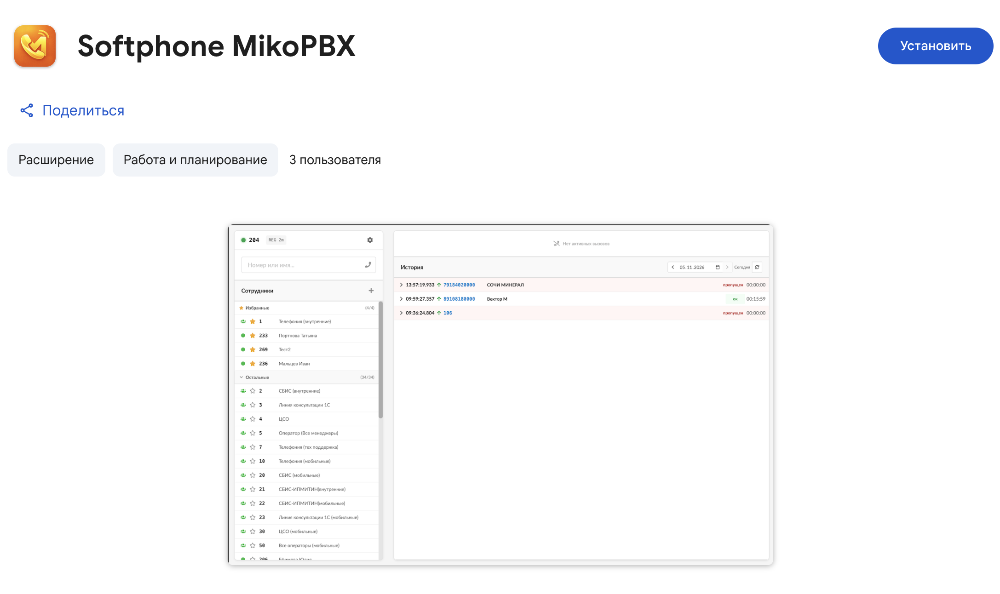
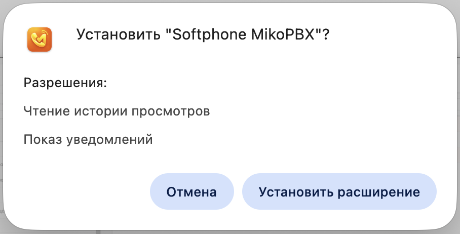
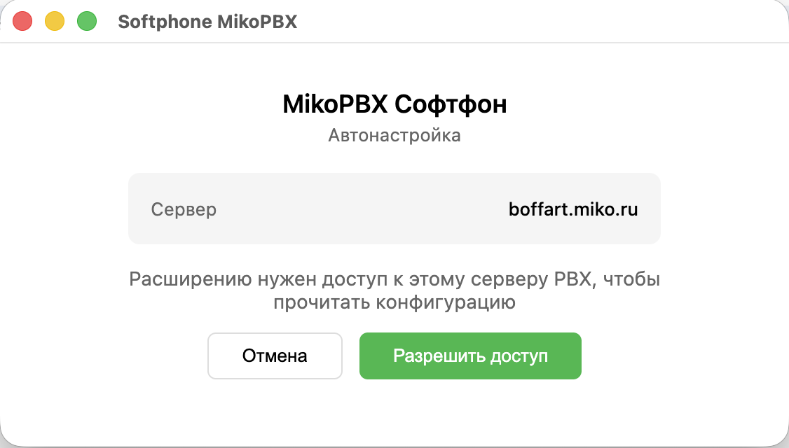
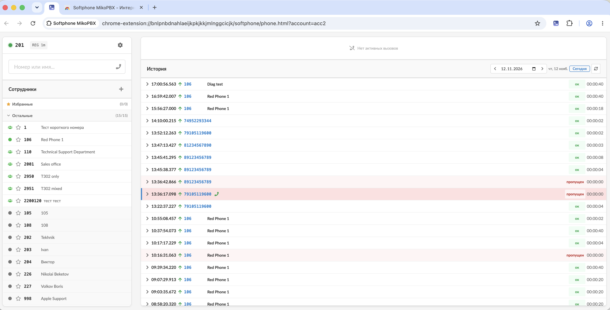

# Softphone MikoPBX (Google Chrome)

**Softphone MikoPBX** — расширение для браузера Google Chrome, которое превращает браузер в софтфон АТС. Звонки идут по WebRTC прямо из браузера, отдельная программа не нужна. В окне софтфона видны список сотрудников с их статусами и история звонков.

Расширение работает через модуль [MikoTalk: API для push софтфона](../../modules/miko/softfon-mikotalk.md). Перед подключением сотрудников выполните шаги 1–4 из раздела [Установка](../../modules/miko/softfon-mikotalk.md#install): установите модуль, выпустите SSL-сертификат и настройте сетевой экран.

## Установка расширения 

1. Откройте страницу расширения [Softphone MikoPBX в Chrome Web Store](https://chromewebstore.google.com/detail/softphone-mikopbx/bnlpnbdnahlaeijkpkjkkjmlnggcicjk) и нажмите **«Установить»**.

<figure><figcaption>
Страница расширения в Chrome Web Store
</figcaption></figure>

2. Подтвердите установку кнопкой **«Установить расширение»**. Разрешения нужны, чтобы расширение распознало открытую ссылку автонастройки и показывало уведомления о входящих звонках.

<figure><figcaption>
Подтверждение установки
</figcaption></figure>

## Подключение по ссылке автонастройки 

1. Получите ссылку автонастройки для внутреннего номера сотрудника. Её создают в настройках модуля MikoTalk на вкладке **«Настройка устройств»**. Порядок действий описан в разделе [Ссылка автонастройки](../../modules/miko/softfon-mikotalk.md#provision). Ссылку можно также отправить сотруднику по email.
2. Откройте ссылку в Chrome, в котором уже установлено расширение. Расширение само распознает ссылку и откроет окно **«Автонастройка»**.
3. При первом подключении к АТС расширение запросит доступ к её адресу. Нажмите **«Разрешить доступ»** и подтвердите запрос Chrome.

<figure><figcaption>
Запрос доступа к серверу АТС
</figcaption></figure>

4. Проверьте сервер и внутренний номер и нажмите **«Применить»**. Расширение создаст учётную запись (или обновит существующую для этого номера) и откроет вкладку софтфона.

Когда в верхней части окна появится зелёный индикатор и метка **REG**, софтфон зарегистрирован на АТС и готов к звонкам.


Если ссылка одноразовая или у неё истёк срок действия, повторно открыть её не получится — создайте новую. Ссылку открывайте только после установки расширения: иначе одноразовая ссылка будет израсходована, а настройки не применятся.


## Работа с софтфоном 

<figure><figcaption>
Окно софтфона: сотрудники слева, история звонков справа
</figcaption></figure>

* **Звонок** — наберите номер или имя в строке поиска либо щёлкните по свободному сотруднику в списке.
* **Статусы сотрудников** — цветной индикатор рядом с номером показывает, свободен сотрудник, разговаривает или не в сети. Сотрудники и очереди отображаются в зависимости от [прав доступа](../../modules/miko/softfon-mikotalk.md#access).

### Группы сотрудников 

Список сотрудников можно разложить по своим группам:

* **Создать группу** — кнопка **«+»** в заголовке **«Сотрудники»**: введите название и нажмите Enter.
* **Переместить сотрудника** — перетащите его мышью в нужную группу или щёлкните правой кнопкой и выберите **«Переместить в «…»»**. Команда **«Убрать из группы»** возвращает сотрудника в раздел **«Остальные»**.
* **Избранные** — звёздочка рядом с сотрудником добавляет его в группу **«Избранные»** в верху списка.
* Группы можно переименовывать, удалять, сворачивать и менять местами. При удалении группы её участники возвращаются в раздел **«Остальные»**.


Это личные группы для удобства: они хранятся в браузере сотрудника и не влияют на права доступа. Права настраиваются администратором в группах доступа модуля — см. [Права доступа и супервизоры](../../modules/miko/softfon-mikotalk.md#access).


### История звонков и записи разговоров 

Справа отображается история звонков за выбранный день. Даты переключаются стрелками, кнопкой **«Сегодня»** или в календаре. Непринятые вызовы выделены и отмечены как **«пропущен»**.

Если разговор записывался, раскройте звонок стрелкой слева: там будет проигрыватель, в котором запись можно прослушать прямо в браузере.


Проигрыватель видят только сотрудники с правом **«Прослушивание записей разговоров»**, а его выдают [супервизору](softphone-mikopbx-chrome.md#supervisor) на звонки контролируемых групп. Обычные сотрудники видят историю звонков без записей.


## Права супервизора 

Сотрудник, назначенный [супервизором](../../modules/miko/softfon-mikotalk.md#supervisors) в модуле MikoTalk, получает в расширении дополнительные действия над звонками сотрудников контролируемых групп. Щёлкните по сотруднику, который разговаривает, и выберите действие:

| Действие                       | Что происходит                                                           |
| ------------------------------ | ------------------------------------------------------------------------ |
| **Подслушать разговор**        | Супервизор слышит разговор, участники его не слышат                      |
| **Шепнуть коллеге**            | Супервизор говорит с сотрудником, собеседник сотрудника его не слышит    |
| **Присоединиться к разговору** | Супервизор становится участником разговора, его слышат обе стороны       |
| **Перехватить**                | Входящий звонок, который поступает сотруднику, принимает супервизор      |
| Прослушивание записей          | Проигрыватель записей в истории звонков сотрудников контролируемых групп |

Перехват доступен и обычным сотрудникам, если у их группы доступа включено право **«Перехват звонков внутри своей группы»**. В списке такой звонок отмечен подсказкой **«Можно перехватить»**.

Набор доступных действий зависит от разрешений, выданных супервизору на вкладке **«Права доступа»** модуля: действия без разрешения в меню не показываются.
