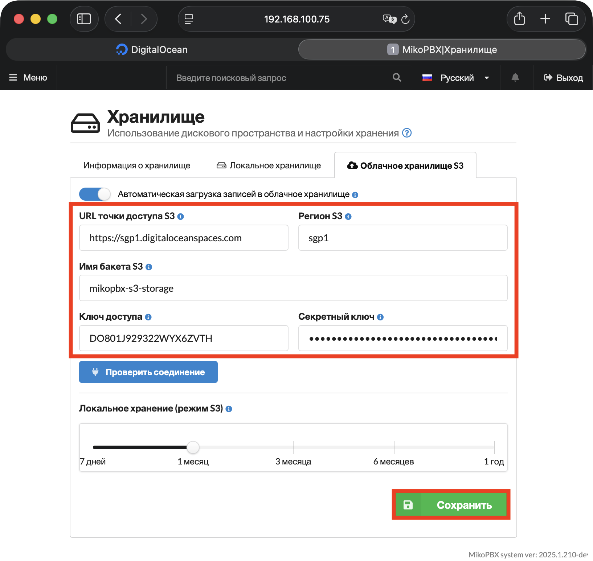

# Переезд на другой S3 бакет

В данной инструкции описан перенос записей разговоров из одного S3-бакета в другой - например, при смене провайдера облачного хранилища. Записи переносятся без остановки станции: MikoPBX продолжает выгружать новые файлы, а история разговоров сохраняет доступ к старым записям.

### Порядок переезда

1. Скопируйте каталог `recordings/` из старого бакета в новый. Это можно сделать утилитой [rclone](https://rclone.org/):

```bash
rclone sync old:bucket/recordings new:bucket/recordings
```

Если старый и новый бакеты находятся у разных провайдеров, можно также воспользоваться `aws s3 sync`, скопировав данные через локальную машину.

2. В разделе "**Обслуживание**" -> "**Хранилище**" на вкладке "**Облачное хранилище S3**" укажите параметры нового бакета и нажмите "**Сохранить**".

<figure><figcaption><p>Пример заполненных данных для подключения S3</p></figcaption></figure>

3. Повторно выполните команду копирования из шага 1. Она докопирует записи, которые станция успела выгрузить в старый бакет между первым копированием и переключением настроек.


MikoPBX выгружает записи в S3 раз в 5 минут, поэтому за время переключения в старый бакет могут попасть новые файлы.


4. Сверьте количество объектов в старом и новом бакетах. Затем откройте [историю звонков](../../telephony/call-detail-records.md) и проверьте воспроизведение нескольких старых записей.
5. Удалите старый бакет.


Чтобы подстраховаться, вместо немедленного удаления настройте на старом бакете lifecycle-правило, которое удалит объекты через N дней.\
\
Дополнительно настраивать mapping записей и бакета не требуется. После переезда удаление записей по сроку хранения автоматически начнёт работать с новым бакетом.

