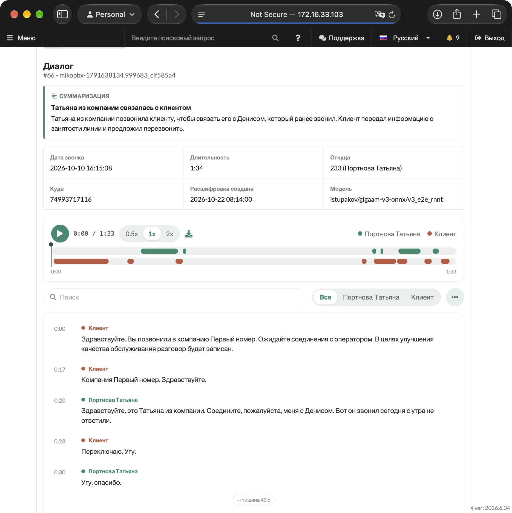
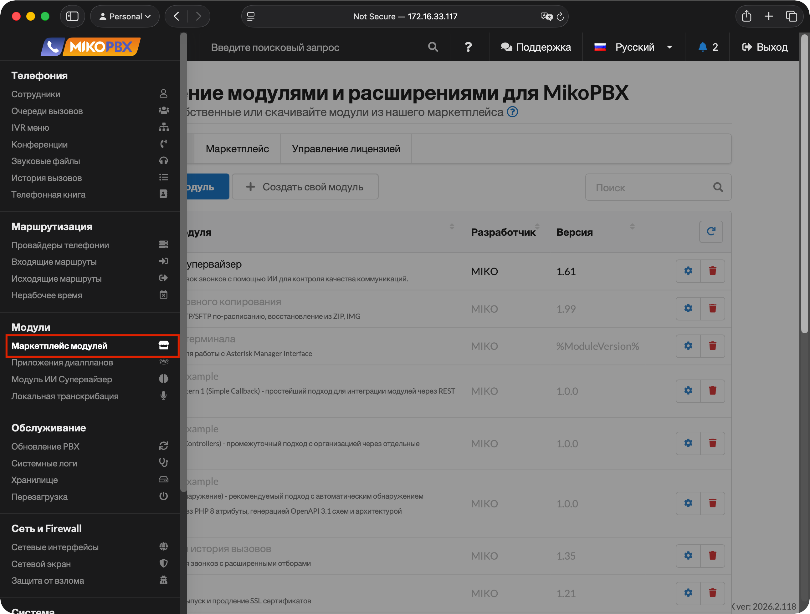
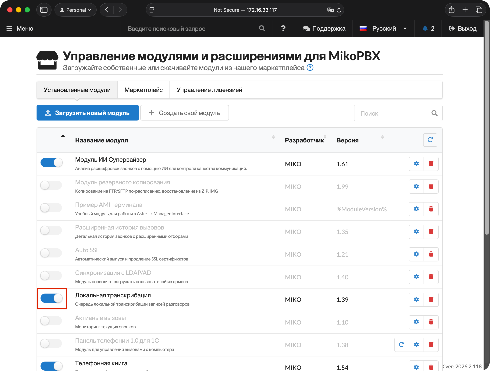
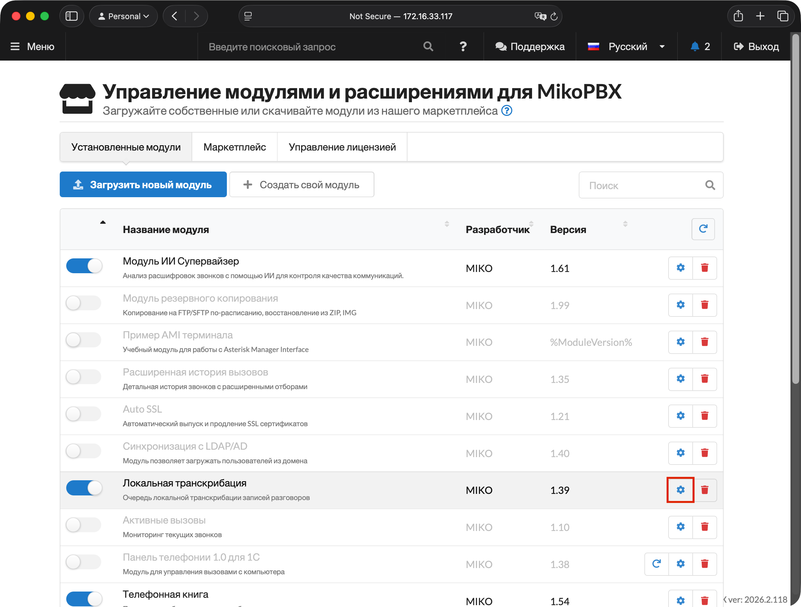
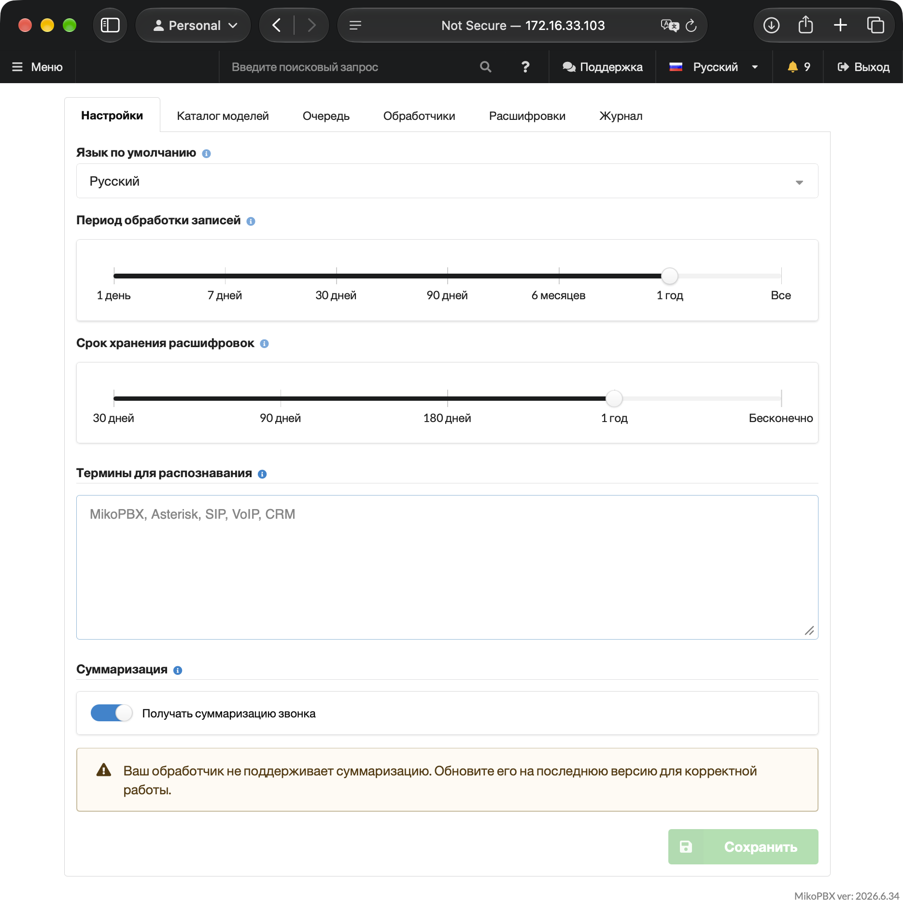
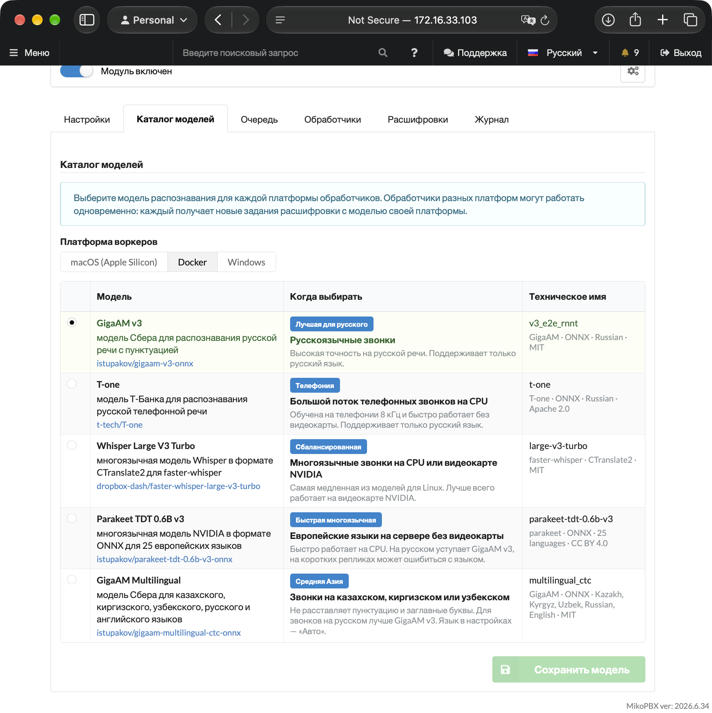
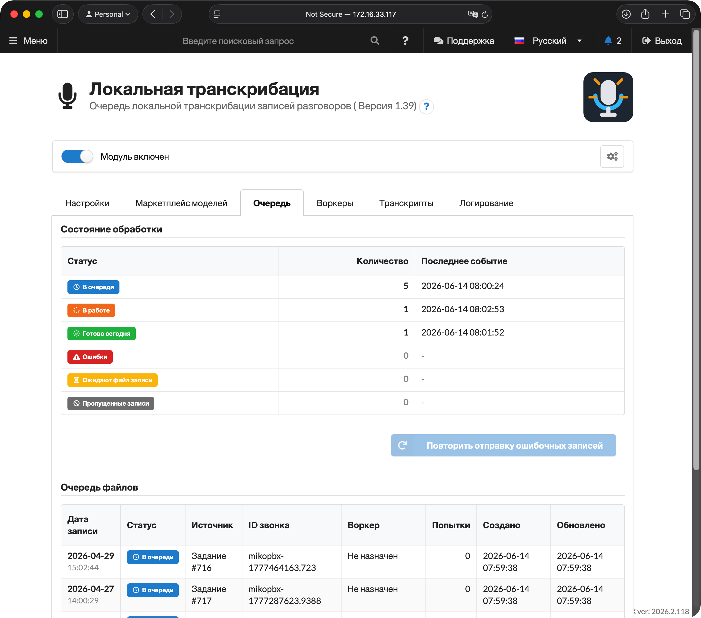
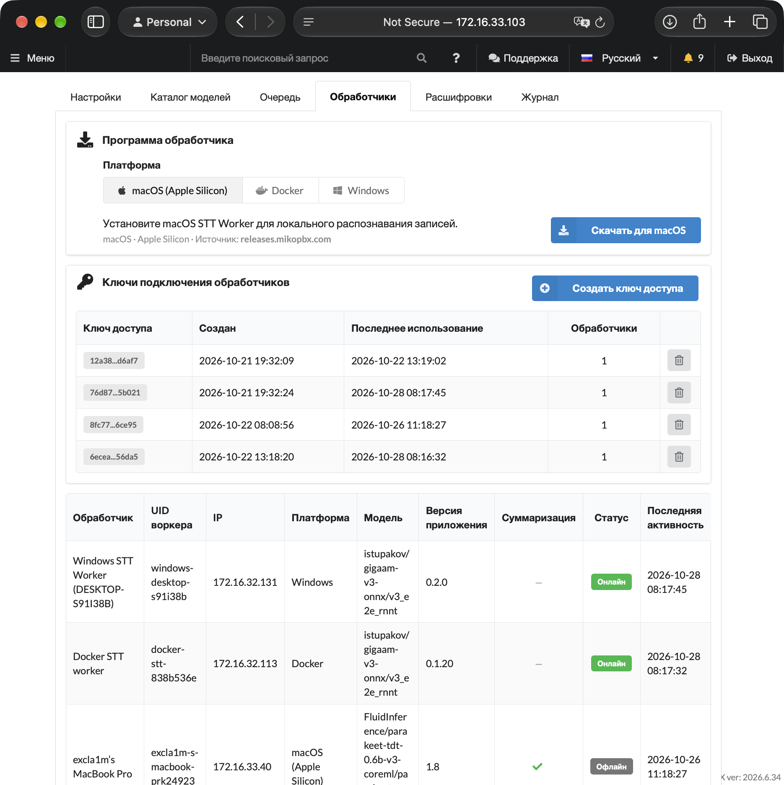
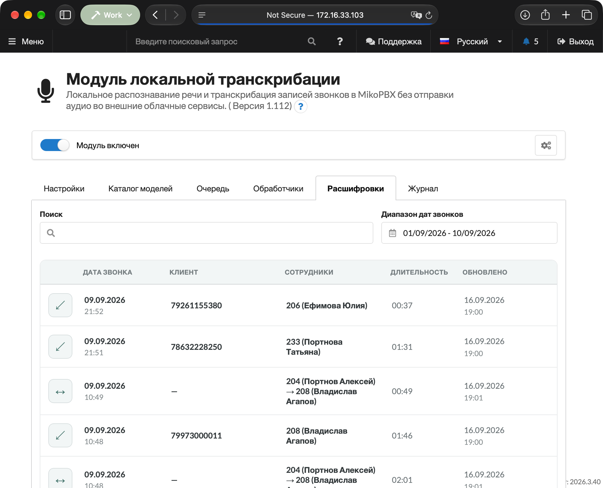
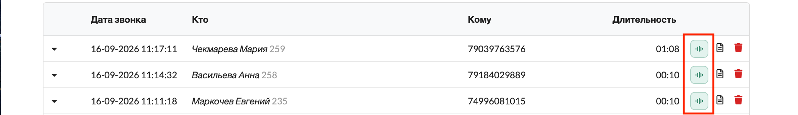

# Локальная транскрибация

**Модуль локальной транскрибации** распознает речь в записанных звонках MikoPBX и сохраняет готовую расшифровку как диалог. Аудиофайлы не отправляются во внешние облачные сервисы: PBX создает очередь заданий, а отдельный **обработчик** скачивает назначенную запись, распознает ее локально выбранной в MikoPBX моделью и отправляет результат обратно в MikoPBX.

По желанию обработчик также составляет **суммаризацию** - тему и краткое содержание каждого разговора. Она тоже выполняется локально, тем же обработчиком.


PBX-модуль работает внутри MikoPBX, а распознавание выполняет обработчик на отдельном компьютере или сервере. Обработчик бывает трех видов: приложение для Mac, Docker-контейнер и служба Windows. Сравнение приведено в разделе **Виды обработчиков** ниже.


<figure><figcaption>
Пример результата транскрибации
</figcaption></figure>

### Виды обработчиков

|                     | **Local STT Worker для macOS**                                      | **Docker-обработчик**                                                                                   | **Windows-обработчик**                                                    |
| ------------------- | ------------------------------------------------------------------- | ------------------------------------------------------------------------------------------------------- | ------------------------------------------------------------------------- |
| Где работает        | Mac на Apple Silicon (M1 и новее), macOS 14 или новее               | Linux-сервер или Mac с Docker, x86\_64 или arm64                                                        | Windows 10/11 или Windows Server 2019 и новее, x64                        |
| Как устанавливается | Приложение, кнопка **Скачать для macOS** на вкладке **Обработчики** | Образ [`excla1m/mikopbx-stt-worker`](https://hub.docker.com/r/excla1m/mikopbx-stt-worker) из Docker Hub | Служба Windows, кнопка **Скачать для Windows** на вкладке **Обработчики** |
| Модели              | Parakeet и Whisper на Core ML с ускорением Apple                    | GigaAM v3, GigaAM Multilingual, T-one, Parakeet и Whisper Turbo на CPU                                  | GigaAM v3, GigaAM Multilingual, Parakeet и Whisper Turbo на CPU           |
| Когда выбирать      | Есть свободный Mac; нужен Whisper с аппаратным ускорением           | Есть Linux-сервер или виртуальная машина; основная часть звонков на русском                             | Есть свободный компьютер или сервер на Windows                            |
| Подробнее           | [Local STT Worker](miko-ai-worker.md)                               | [Docker-обработчик (Linux)](docker-worker.md)                                                           | [Windows-обработчик](windows-worker.md)                                   |

Обработчики разных видов можно подключать одновременно. Для каждой платформы на вкладке **Каталог моделей** выбирается своя модель, и каждый обработчик получает задания с моделью своей платформы. Например, Docker-обработчик может распознавать звонки моделью GigaAM v3, а Mac в это же время - моделью Whisper.

### Как проходит обработка

1. Звонок завершается, и MikoPBX сохраняет запись разговора.
2. Фоновый процесс модуля находит запись и создает задание.
3. Свободный обработчик забирает задание из очереди.
4. PBX отдает назначенному обработчику файл записи.
5. Обработчик подготавливает аудио, распознает речь моделью своей платформы и отправляет сегменты расшифровки.
6. Модуль фильтрует результат, сохраняет расшифровку и публикует событие для интеграций.
7. Если суммаризация включена, обработчик в свободное от распознавания время составляет краткое содержание звонка.

Если обработчик перестает отвечать во время обработки, задание возвращается в очередь. На одно задание отводится до трех попыток, после чего оно попадает в статус **Ошибки**.

### Требования и совместимость

* MikoPBX **2025.1.1** или новее.
* Обработчик одного из видов:
  * **macOS:** Mac на Apple Silicon, macOS **14.0** или новее, от 8 ГБ памяти, около 5 ГБ на диске для моделей;
  * **Docker:** Linux-сервер или Mac с Docker 20.10 или новее, x86\_64 или arm64, от 4 ядер, от 8 ГБ памяти, около 10 ГБ на диске для образа и моделей;
  * **Windows:** Windows 10/11 или Windows Server 2019 и новее, x64, от 8 ГБ памяти, [среда выполнения Visual C++ 2015-2022 x64](https://aka.ms/vs/17/release/vc_redist.x64.exe).
* Для суммаризации - дополнительно около **4 ГБ** оперативной памяти и **3 ГБ** на диске у обработчика.
* Включенная запись разговоров для нужных маршрутов, очередей или сотрудников.
* Сетевой доступ от обработчика к веб-интерфейсу MikoPBX. Веб-интерфейс необходимо открывать по HTTPS: при подключении по HTTP созданный ключ доступа не показывается.
* Интернет при первой загрузке выбранной модели и ее служебных файлов. После загрузки модели для обработки достаточно доступа к PBX.

### Установка модуля

1. Откройте веб-интерфейс MikoPBX.
2. Перейдите в раздел **Модули** → **Маркетплейс модулей**.

<figure><figcaption>
Маркетплейс модулей
</figcaption></figure>

3. Найдите **Модуль локальной транскрибации** и установите его.
4. Откройте список установленных модулей и включите модуль.

<figure><figcaption>
Включение модуля
</figcaption></figure>

5. Нажмите кнопку настроек справа от версии модуля.

<figure><figcaption>
Переход на страницу модуля
</figcaption></figure>

### Вкладка «Настройки»

| Настройка                        | По умолчанию             | Назначение                                                                                                             |
| -------------------------------- | ------------------------ | ---------------------------------------------------------------------------------------------------------------------- |
| **Язык по умолчанию**            | Определять автоматически | Языковая подсказка для модели распознавания. В автоматическом режиме язык звонка определяется при распознавании.       |
| **Период обработки записей**     | `30 дней`                | За какой период искать завершенные звонки с записью: 1 день, 7, 30, 90 дней, 6 месяцев, 1 год или все записи.          |
| **Срок хранения расшифровок**    | `1 год`                  | Через сколько удалять результаты транскрибации: 30, 90, 180 дней, 1 год или бесконечно.                                |
| **Термины для распознавания**    | пусто                    | Названия компаний, продуктов, систем и другие слова-подсказки.                                                         |
| **Получать суммаризацию звонка** | выключено                | Составлять для каждого нового звонка тему и краткое содержание разговора. Подробнее - в разделе **Суммаризация** ниже. |

Период обработки не может превышать срок хранения расшифровок: при конфликте модуль показывает предупреждение и не дает сохранить настройки. Срок хранения отсчитывается от завершения распознавания; CDR и исходные аудиозаписи не удаляются.

В списке **Язык по умолчанию** показываются только языки, которые поддерживают модели, выбранные на вкладке **Каталог моделей**. Если вы выбрали модели для нескольких платформ, в списке останутся языки, общие для всех этих моделей. Платформа, для которой модель не меняли, список не ограничивает.


При изменении периода обработки позиция сканирования сбрасывается, чтобы модуль пересмотрел историю в новом диапазоне.


<figure><figcaption>
Раздел настроек модуля
</figcaption></figure>

#### Суммаризация

Когда переключатель **Получать суммаризацию звонка** включен, обработчик после распознавания составляет для звонка **тему** и **краткое содержание** в одно-два предложения. Суммаризация выполняется на вашем обработчике моделью **Gemma 3 4B**, разговор никуда не отправляется.

* Суммаризация составляется одна на весь звонок. Если звонок переводили, в нее попадают все части разговора.
* Распознавание всегда важнее: обработчик берется за суммаризацию, только когда в очереди нет записей для распознавания.
* Модель скачивается обработчиком при первом включении, распознавание в это время продолжает работать.
* Обработчику нужно дополнительно около **4 ГБ** оперативной памяти и **3 ГБ** на диске.
* Суммаризация составляется только для звонков, расшифрованных после включения настройки.

Суммаризацию выполняют обработчики последних версий; в таблице на вкладке **Обработчики** у них отмечена колонка **Суммаризация**. Если настройка включена, а ни один подключенный обработчик ее не поддерживает, модуль показывает предупреждение: обновите обработчик до последней версии.

### Вкладка «Каталог моделей»

Здесь для каждой платформы обработчиков выбирается модель, которую PBX передает в новые задания. Обработчики разных платформ работают одновременно, и каждый получает задания с моделью своей платформы.

Переключатель **Платформа воркеров** над списком показывает модели выбранной платформы. Описание моделей, поддерживаемые языки и рекомендации по выбору приведены в разделе **Модели** статьи об обработчике:

* **macOS (Apple Silicon)** - Parakeet и Whisper на Core ML: [Local STT Worker](miko-ai-worker.md);
* **Docker** - GigaAM, T-one, Parakeet и Whisper на CPU: [Docker-обработчик (Linux)](docker-worker.md);
* **Windows** - GigaAM, Parakeet и Whisper на CPU: [Windows-обработчик](windows-worker.md).

Выберите модель для нужной платформы и нажмите **Сохранить модель**. Если язык по умолчанию на вкладке **Настройки** не поддерживается выбранной моделью, модуль покажет предупреждение: выберите **Определять автоматически** или подходящий язык.

<figure><figcaption>
Выбор модели
</figcaption></figure>

### Вкладка «Очередь»

Блок **Состояние обработки** показывает количество записей в каждом статусе и время последнего события.

| Статус                  | Значение                                                       |
| ----------------------- | -------------------------------------------------------------- |
| **В очереди**           | Задание ждет свободный обработчик.                             |
| **В работе**            | Задание выполняет один из обработчиков.                        |
| **Готово сегодня**      | Задания, завершенные за текущий день.                          |
| **Ошибки**              | Неуспешные задания, которые можно вернуть в очередь.           |
| **Ожидают файл записи** | CDR найден, но файл еще не появился или недоступен для чтения. |
| **Пропущенные записи**  | Записи, которые не будут обработаны без изменения условий.     |

Кнопка **Повторить отправку ошибочных записей** возвращает в очередь все задания из статуса **Ошибки**.

Ниже, в таблице **Очередь файлов**, перечислены сами задания: дата записи, статус, источник, ID звонка, обработчик, число попыток, время создания и последнего изменения. Новые звонки обрабатываются первыми.

<figure><figcaption>
Вид очереди в интерфейсе модуля
</figcaption></figure>

### Вкладка «Обработчики»

На этой вкладке скачивается обработчик, создаются ключи доступа и отображаются подключенные обработчики.

#### Программа обработчика

Переключатель **Платформа** в верхней части вкладки выбирает вид обработчика:

* **macOS (Apple Silicon)** - кнопка **Скачать для macOS** загружает Local STT Worker с `releases.mikopbx.com`.
* **Docker** - показывается готовая команда `docker pull` и `docker run` с адресом этой станции. Сразу после создания ключа доступа он подставляется в команду; ее можно скопировать и выполнить на сервере с Docker. Установка с `compose.yaml` для постоянной работы описана в статье [Docker-обработчик (Linux)](docker-worker.md).
* **Windows** - кнопка **Скачать для Windows** открывает меню с двумя пакетами: **MSI** (установщик, сам регистрирует службу Windows) и **ZIP** (архив для ручной установки). Для каждого пакета указаны имя файла и размер. Ниже приведены команды `setup`, `install` и `status` для командной строки администратора. Подробнее - в статье [Windows-обработчик](windows-worker.md).

#### Ключи подключения обработчиков

Кнопка **Создать ключ доступа** создает новый ключ. Он показывается только один раз, после создания - сразу скопируйте его.

Один ключ не может быть привязан сразу к нескольким `worker_uid`; для нескольких обработчиков создайте отдельные ключи.

#### Подключенные обработчики

Таблица обработчиков показывает имя, UID, IP, платформу, модель, версию обработчика, поддержку суммаризации, состояние и последнюю активность. Несовместимый обработчик отображается офлайн.

Пока ни один обработчик не подключен, на платформе **macOS (Apple Silicon)** над таблицей выводится подсказка **Как подключить обработчик** из трех шагов.

<figure><figcaption>
Вкладка обработчиков
</figcaption></figure>

### Вкладка «Расшифровки»

Список можно фильтровать по диапазону дат звонков и искать по тексту расшифровок. Нажатие на строку открывает диалог.

<figure><figcaption>
Список расшифровок
</figcaption></figure>

#### Карточка диалога

В верхней части карточки находится проигрыватель записи: скорость воспроизведения переключается между **0.5x**, **1x** и **2x**, а кнопка **Скачать запись** сохраняет аудиофайл. Нажатие на реплику или на шкалу переводит проигрыватель к соответствующему моменту.

Если во время звонка сотрудник консультировался с коллегой, разговор разбит на вкладки **Разговор с клиентом** и **Внутренняя консультация**.

Когда включена суммаризация, над диалогом показывается блок **Суммаризация** с темой и кратким содержанием звонка. Если суммаризация еще не готова, разговор слишком короткий или звонок расшифрован до включения настройки, в блоке будет соответствующее сообщение.

Меню действий в карточке позволяет **Скачать TXT**, **Скачать JSON** и **Удалить транскрипт**. При удалении требуется подтверждение: удаляются расшифровка и связанные данные модуля, а CDR MikoPBX и исходная запись разговора сохраняются.

<figure><figcaption>
Вид карточки расшифровки
</figcaption></figure>

### Расшифровка в истории звонков

Модуль добавляет в раздел **История звонков** MikoPBX кнопку **Показать расшифровку** для звонков с готовой расшифровкой. Она открывает окно **Расшифровка звонка** с тем же проигрывателем, блоком **Суммаризация** и меню действий, что и в карточке диалога.

<figure><figcaption>
Кнопка для открытия расшифровки из журнала CDR
</figcaption></figure>

### Вкладка «Журнал»

Журнал содержит структурированные технические события модуля и обработчиков без расшифровок, аудиозаписей и секретов.

### Права доступа

При использовании модуля управления доступом пользователей (ModuleUsersUI) для модуля локальной транскрибации доступны отдельные права:

| Право                                                     | Что открывает                                                                      |
| --------------------------------------------------------- | ---------------------------------------------------------------------------------- |
| **Просмотр расшифровок и записей звонков**                | Вкладка **Расшифровки**, карточка диалога, экспорт, расшифровка в истории звонков. |
| **Удаление транскриптов**                                 | Действие **Удалить транскрипт** в карточке диалога.                                |
| **Управление настройками модуля**                         | Вкладки **Настройки** и **Каталог моделей**.                                       |
| **Подключение обработчиков, просмотр очереди и журналов** | Вкладки **Очередь**, **Обработчики** и **Журнал**.                                 |

Вкладки, на которые у пользователя нет прав, не отображаются. REST API модуля через эти права не открывается.
