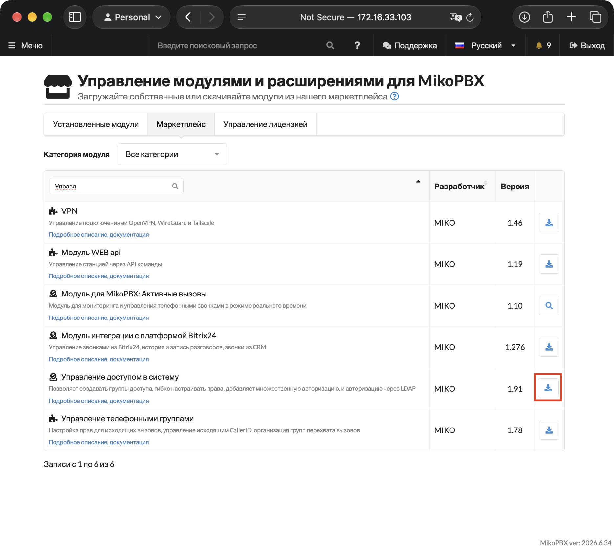
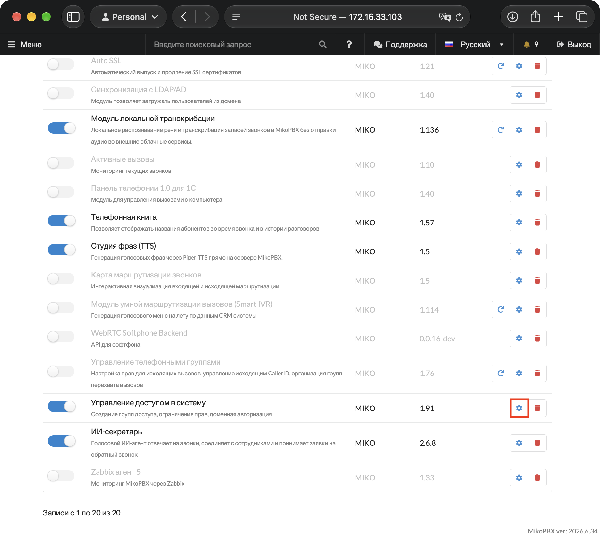
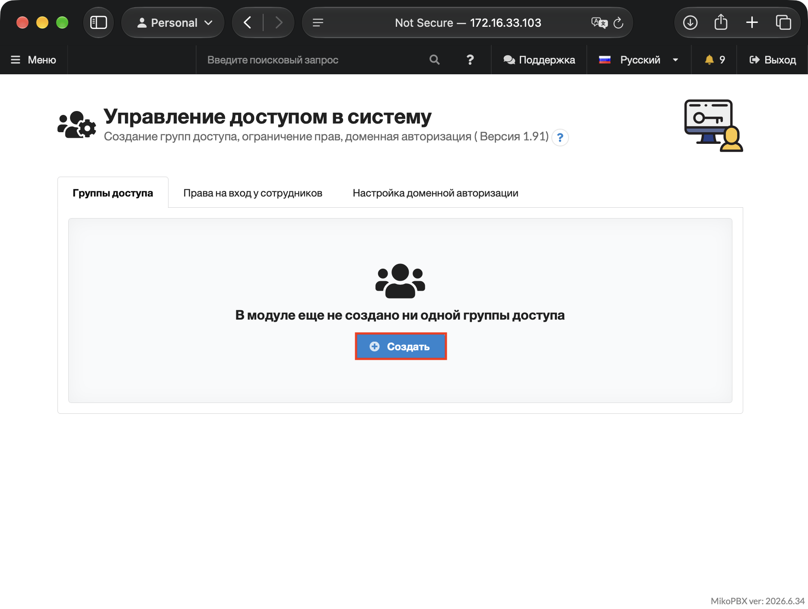
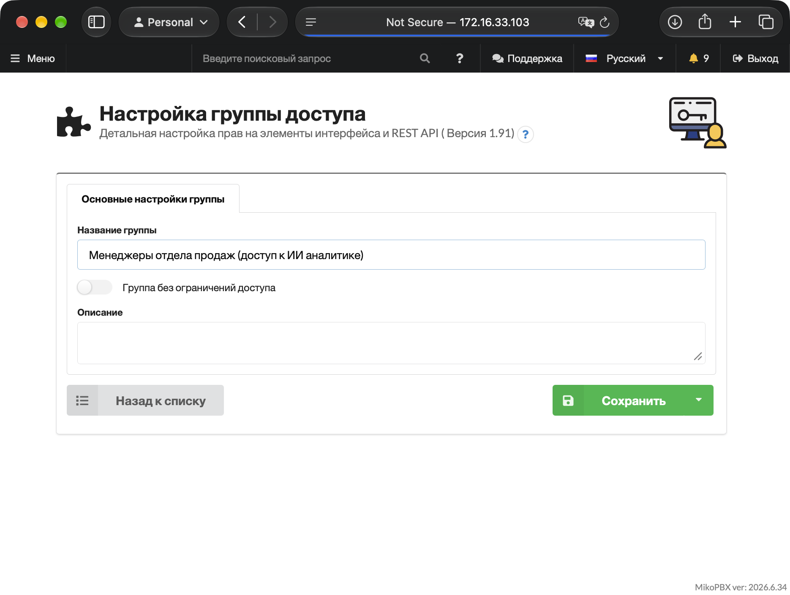
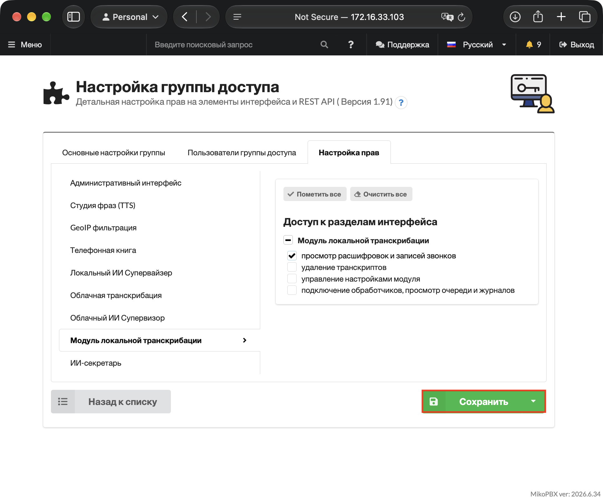
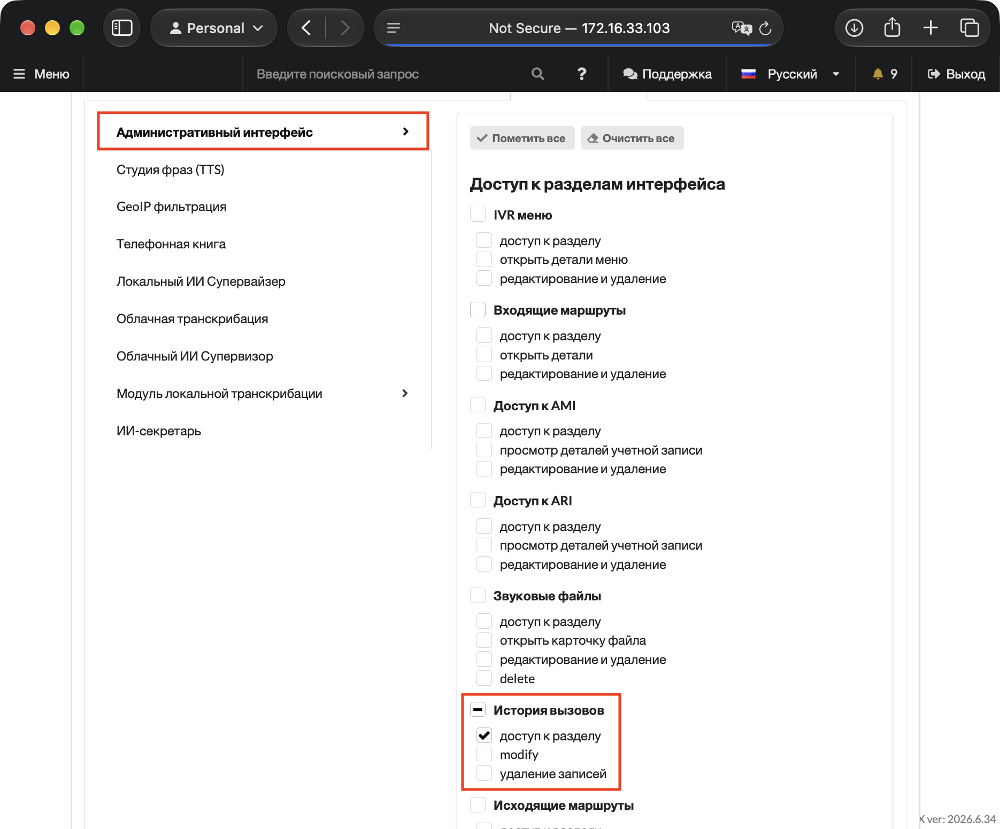
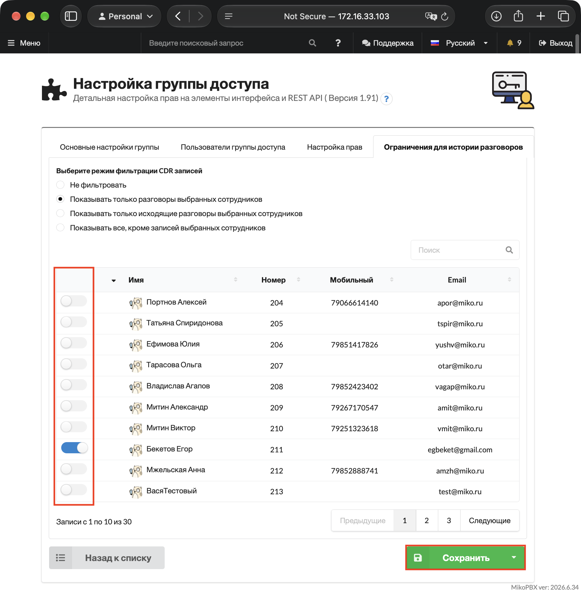
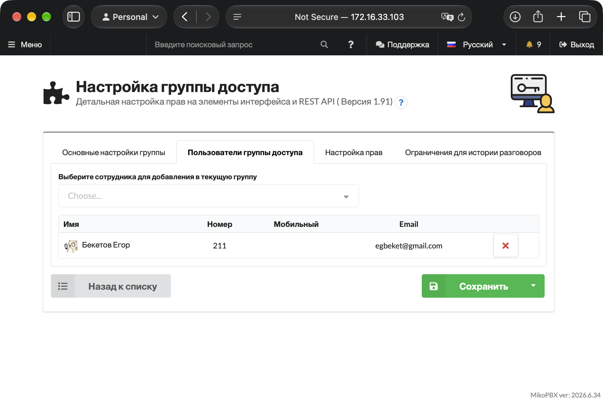
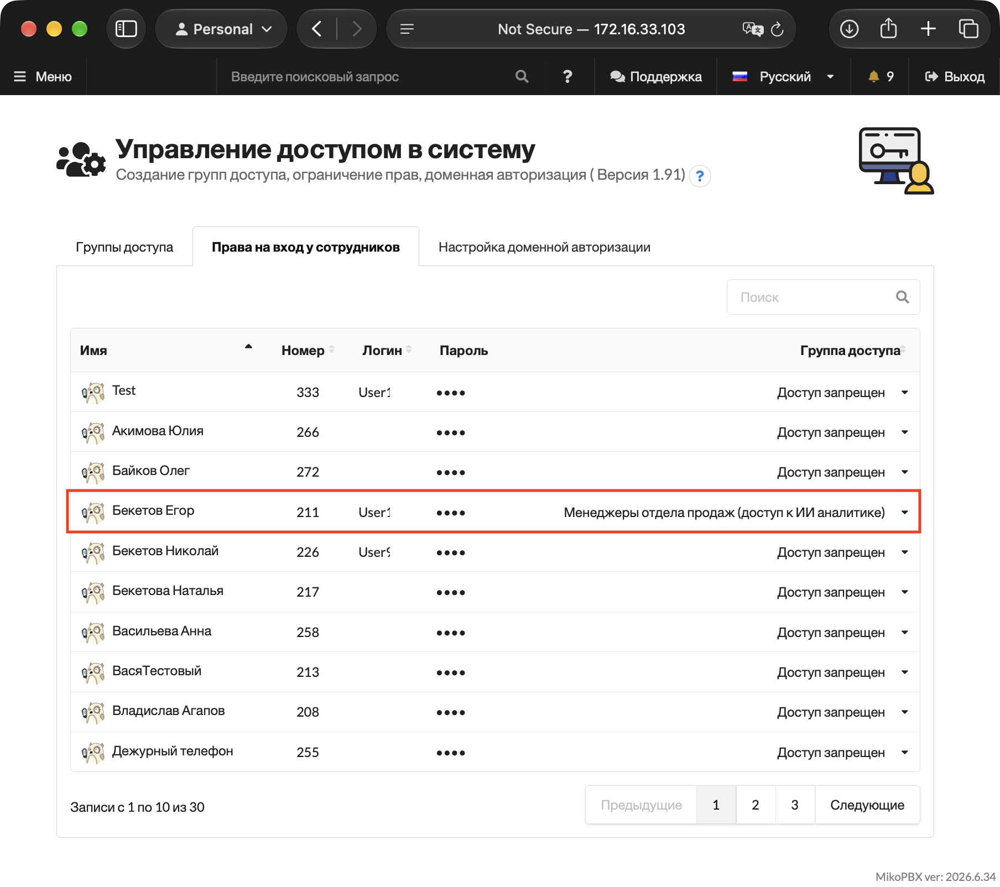

# Предоставление доступа к звонкам определенных сотрудников

Иногда руководителю отдела нужно открыть доступ к звонкам не всех, а лишь некоторых подчиненных. Из этой статьи вы узнаете, как пошагово выполнить такую настройку.

1. Установите модуль "[Управление доступом в систему](../module-users-u-i.md)".

<figure><figcaption>
Установка модуля управления доступом в систему
</figcaption></figure>

2. Включите модуль и перейдите в его настройки.

<figure><figcaption>
Переход в настройки модуля Управления доступом в систему
</figcaption></figure>

3. Создайте новую группу доступа.

<figure><figcaption>
Создание новой группы доступа
</figcaption></figure>

4. Задайте название новой группе и нажмите "Сохранить".

<figure><figcaption>
Параметры создаваемой группы
</figcaption></figure>

5. После сохранения настроек у Вас откроется раздел с управлением правами доступа. Перейдите во вкладку "Модуль локальной транскрибации" и поставьте галочку напротив "просмотр расшифровок и записей звонков". Сохраните настройку.

<figure><figcaption>
Настройка доступа
</figcaption></figure>

6. Перейдите в раздел "Административный интрфейс". Поставьте там галочку напротив "Доступ к разделу" в "История вызовов". Сохраните настройки.

<figure><figcaption>
Выдача прав на доступ к разделу История вызовов
</figcaption></figure>

7. После сохранения настроек, у Вас появится раздел "Ограничения для истории разговоров". В нем выберите к звонками каких сотрудников у менеджера будет доступ.&#x20;

<figure><figcaption>
Настройка к записям каких сотрудников будет доступ
</figcaption></figure>

8. Перейдите в раздел "Пользователи группы доступа" и добавьте учетку менеджера к текущей группе.

<figure><figcaption>
Добавление пользователя в группу доступа
</figcaption></figure>

9. Вернитесь на главную страницу модуля. Задайте данные для входа Вашему менеджеру (логин и пароль).

<figure><figcaption>
Добавление данных для входа менеджеру
</figcaption></figure>

Далее менеджер должен авторизоваться в веб-интерфейсе MikoPBX с его данными. Он получит доступ только к разделу со звонками и к локальной транскрибации, к записям сотрудников которых Вы разрешили.
