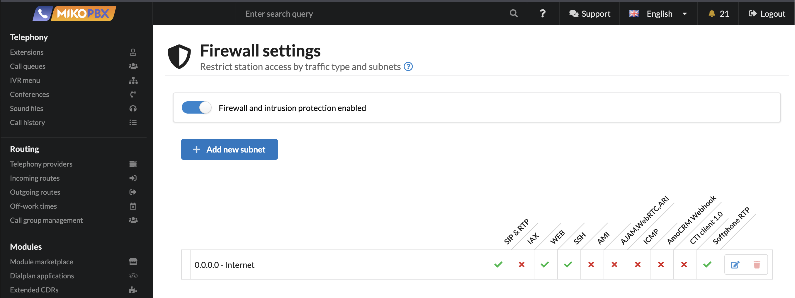
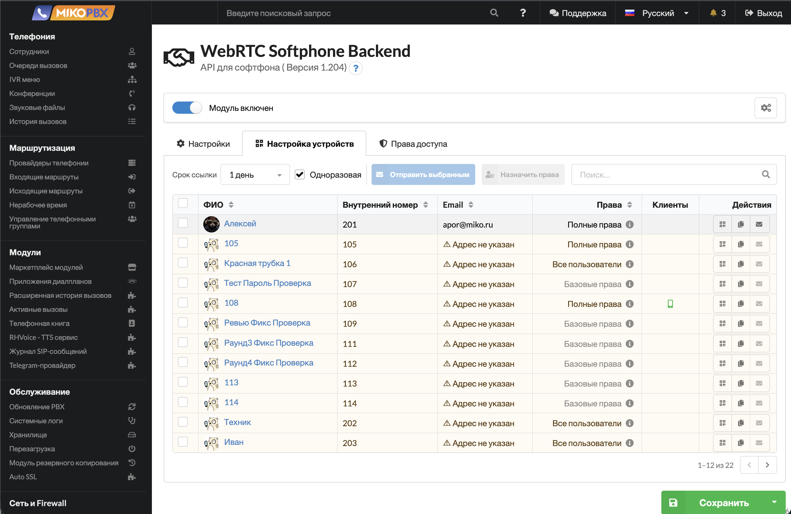
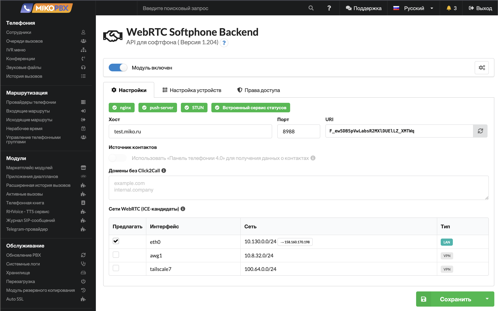
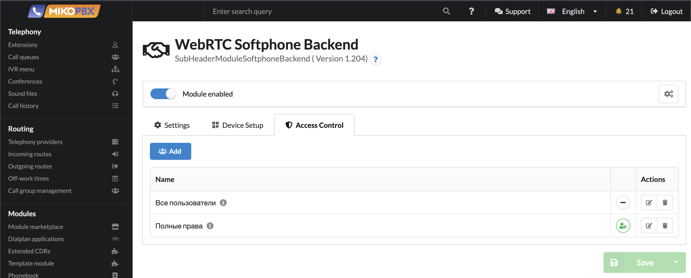
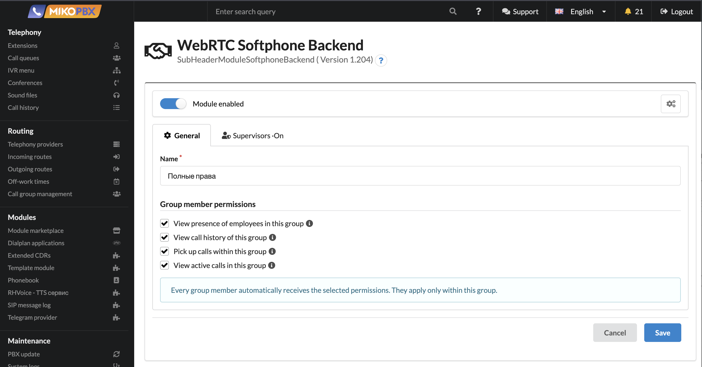
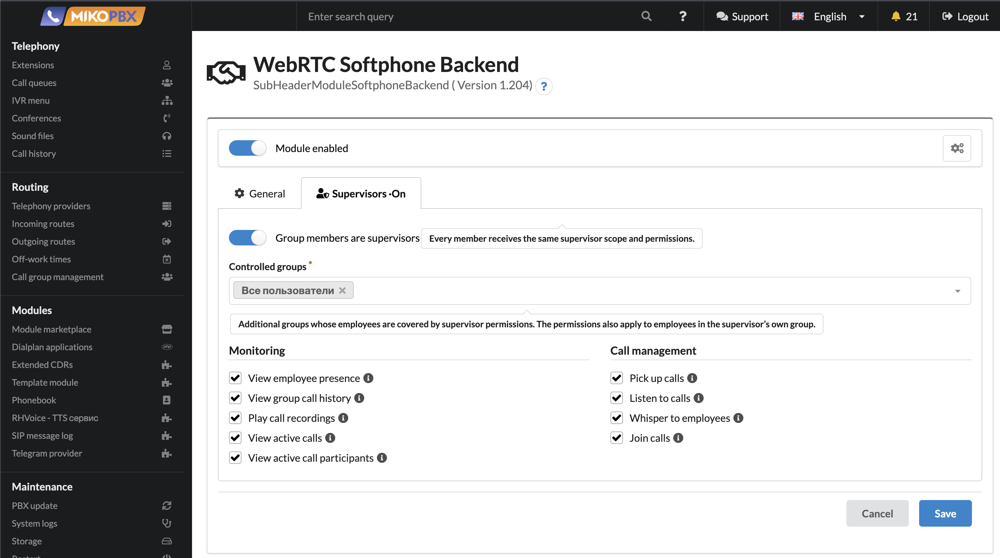

# Софтфон MikoTalk

Модуль **MikoTalk: API для push софтфона** (MikoTalk Push Softphone API) превращает iPhone сотрудника в полноценный софтфон АТС: звонки по Wi-Fi и мобильному интернету, входящие вызовы через push-уведомление — как обычный звонок, даже если приложение закрыто.

Для настройки софтфона достаточно отсканировать QR-код или перейти по ссылке автонастройки.

## Возможности 

| Возможность             | Описание                                                                                                                                                                                                                       |
| ----------------------- | ------------------------------------------------------------------------------------------------------------------------------------------------------------------------------------------------------------------------------ |
| Push-звонки             | Оповещения о входящих звонках поступят, даже если приложение закрыто или устройство «спит»                                                                                                                                     |
| История звонков         | Пользователь приложения MikoTalk видит всю историю звонков с учётом ограничений прав доступа ([инструкции по настройке прав](module-softphone-backend.md#access)). Запись разговора можно прослушать прямо из истории звонков                             |
| Контакты                | Имя клиента может быть определено по данным оператора связи, если он передаёт эту информацию, или по данным 1С — для этого можно подключить модуль [«Панели телефонии 4.0»](https://docs.telefon1c.ru/v4/get-started/mikopbx/) |
| Статусы сотрудников     | Кто свободен, кто разговаривает. Очереди вызовов видны всем                                                                                                                                                                    |
| Перевод и перехват      | Слепой и сопровождаемый перевод звонка, перехват входящего звонка коллеги                                                                                                                                                      |
| Инструменты супервизора | Подслушивание, подсказка сотруднику, подключение к разговору, наблюдение за группами                                                                                                                                           |
| Пропущенные вызовы      | Непринятые звонки отмечаются в приложении отдельным счётчиком                                                                                                                                                                  |

## Установка 

Подключение софтфона состоит из четырёх шагов: подготовить АТС, выпустить SSL-сертификат, установить модуль и подключить iPhone сотрудника.

### Шаг 1. Установите MikoPBX 

Установите MikoPBX версии **2026.1.223** или новее — на отдельный компьютер, в виртуальную машину или облако. Порядок действий описан в разделе [Быстрое начало работы](../../readme/quick-start.md). Если АТС уже работает, проверьте версию и при необходимости обновитесь.

Чтобы сотрудники могли звонить из мобильного интернета, АТС должна быть доступна извне: публичный статический IP-адрес или проброс портов (1:1 NAT). Список портов и настройка встроенного firewall — в разделе [Системные требования](module-softphone-backend.md#system-requirements).

### Шаг 2. Получите SSL-сертификат 

Приложение подключается к АТС только по защищённому соединению (HTTPS/WSS), поэтому нужен доверенный сертификат — самоподписанный не подойдёт.

1. Установите из маркетплейса модуль [«Генератор SSL сертификатов через Let's Encrypt»](module-get-ssl-lets-encrypt.md).
2. В настройках модуля укажите внешний IP-адрес АТС — доменное имя не обязательно, сертификат выпускается и на IP-адрес.
3. Выберите способ проверки **HTTP-01**: на время проверки АТС должна быть доступна из интернета по порту **80**, а в **«Система» → «Общие настройки» → «HTTP/HTTPS»** — отключён **«Редирект на HTTPS»**.
4. Включите **«Обновлять сертификат автоматически»** и нажмите **«Получить/обновить SSL сертификат»**.


Сертификат Let's Encrypt на IP-адрес — краткосрочный, он действует всего несколько дней. Модуль автоматически пытается обновить его каждый 5-й день, если включена опция **«Обновлять сертификат автоматически»** — не отключайте её: с истёкшим сертификатом приложение перестанет подключаться к АТС. Подробнее о настройке модуля и проверке выпущенного сертификата — в [инструкции по модулю Let's Encrypt](module-get-ssl-lets-encrypt.md).


### Шаг 3. Установите модуль MikoTalk 

1. В разделе **«Модули» → «Маркетплейс модулей»** ([подробнее о маркетплейсе](../../manual/modules/pbx-extension-modules.md#marketpleis-modulei)) установите модуль **«MikoTalk: API для push софтфона»** (ранее — «WebRTC Softphone Backend»).
2. Включите модуль на вкладке **«Установленные модули»**. При первой установке автоматически активируется пробная лицензия — см. [Требования и лицензирование](module-softphone-backend.md#requirements).
3. Откройте настройки модуля: **«Модули» → «MikoTalk: API для push софтфона»**.
4. Дождитесь, когда индикаторы [панели состояния](module-softphone-backend.md#health) станут зелёными — обычно это занимает до минуты после включения:
   * **nginx** — API для приложения опубликован;
   * **push-server** — доставка push-уведомлений работает;
   * **STUN** — встроенный coturn запущен и внешний адрес АТС определён;
   * **Встроенный сервис статусов** — статусы сотрудников и активные вызовы;
   * **SSL-сертификат** — сертификат доверенный и выдан на адрес из настроек [внешнего сервера](module-softphone-backend.md#external-server).


Если индикатор остаётся красным или жёлтым, наведите на него курсор — появится причина. Чаще всего это не заданный или не определившийся внешний адрес АТС либо самоподписанный сертификат: проверьте поля **«Хост»** и **«Соединение»** в [настройках внешнего сервера](module-softphone-backend.md#external-server).


### Шаг 4. Подключите софтфон на iPhone 

1. Установите на iPhone сотрудника приложение [MikoTalk из App Store](https://apps.apple.com/si/app/mikotalk/id6759347414).
2. В настройках модуля, вкладка **«Настройка устройств»**, создайте [ссылку автонастройки](module-softphone-backend.md#provision) для внутреннего номера сотрудника.
3. Отсканируйте QR-код камерой iPhone или откройте на нём письмо со ссылкой, затем подтвердите вход в приложении.
4. Разрешите уведомления — без них входящие звонки не будут приходить.

После подключения сделайте тестовый звонок на внутренний номер сотрудника при закрытом приложении: он должен прийти как обычный входящий вызов.

## Требования и лицензирование 

* MikoPBX не ниже версии **2026.1.223**.
* Лицензия выдаётся **на сотрудника**: все устройства одного сотрудника занимают одну лицензию.


Модуль устанавливается из маркетплейса. При первой установке автоматически активируется **пробная лицензия** — можно проверить работу софтфона до покупки. О регистрации и продлении лицензий читайте в разделе [Регистрация в маркетплейсе модулей](../../manual/modules/licensing.md).


### Системные требования 

Для звонков из мобильного интернета АТС должна быть доступна извне: **публичный статический IP-адрес** либо проброс портов с внешнего IP/домена на АТС (1:1 NAT). Должны быть открыты и проброшены:

| Порт                                                   | Протокол  | Назначение                                                                                                                                                          |
| ------------------------------------------------------ | --------- | ------------------------------------------------------------------------------------------------------------------------------------------------------------------- |
| Внешний порт API (по умолчанию **8988**)               | TCP       | Подключение приложения: авторизация, ссылка автонастройки, история, статусы. Порт задаётся в настройках модуля — см. [Настройка внешнего сервера](module-softphone-backend.md#external-server) |
| **3478** (STUN/TURN, встроенный coturn)                | UDP и TCP | Обход NAT: помогает приложению определить свой внешний адрес и построить маршрут медиа-трафика до АТС                                                               |
| Диапазон RTP-портов АТС (по умолчанию **10000–12000**) | UDP       | Голосовой трафик звонков. Диапазон настраивается в общих настройках сети MikoPBX                                                                                    |

Кроме того, в настройках сетевого экрана самой АТС (**«Система» → «Сеть и Firewall» → «Firewall»**) включите службу **Softphone RTP** для профиля **«Интернет»** — или, как минимум, для **«Доверенных сетей»**, если сотрудники звонят только из офисной сети. Без этого голосовой трафик будет блокироваться встроенным firewall АТС.

<figure><figcaption>
Служба Softphone RTP в настройках сетевого экрана АТС
</figcaption></figure>

Для защищённого соединения (HTTPS/WSS) используйте модуль [Let's Encrypt](module-get-ssl-lets-encrypt.md) — он выпустит доверенный SSL-сертификат. Сертификат можно получить и на IP-адрес, доменное имя не обязательно.

## Подключение клиентов 

### Ссылка автонастройки 

Приложение подключается по ссылке автонастройки. Откройте настройки модуля, вкладку **«Настройка устройств»**:

1. Выберите внутренний номер сотрудника.
2. Укажите срок действия ссылки: 10 минут, 1 час, 5 часов или 1 день.
3. При необходимости включите **«Одноразовая ссылка»** — ссылка перестанет работать после первого использования.
4. Нажмите **«Создать»** — модуль покажет QR-код и саму ссылку.

Ссылку можно передать любым удобным способом, QR-код — отсканировать камерой iPhone. Приложение скачает настройки и попросит подтвердить вход.

<figure><figcaption>
Вкладка «Настройка устройств»
</figcaption></figure>

На этой же вкладке расположена таблица сотрудников: поиск по имени или номеру, отправка письма с QR-кодом одному сотруднику или выбранным (**«Отправить выбранным»**, до 100 за раз). Письмо уходит на адрес электронной почты, указанный в карточке сотрудника.


Для отправки параметров подключения по email предварительно настройте почтовый сервер АТС: **«Система» → «Почта и уведомления»**. Инструкция — в разделе [Почта и уведомления](../../manual/system/mail-settings/README.md).


### Сессии сотрудника 

В настройках модуля для каждого сотрудника показаны его активные сессии и время последней активности. Кнопка **«Завершить все сессии сотрудника»** принудительно разлогинивает все его устройства и освобождает лицензию — используется, например, при утере телефона.

## Настройка модуля 

<figure><figcaption>
Вкладка «Настройки»
</figcaption></figure>

### Внешний сервер 

Параметры, по которым приложение обращается к АТС из интернета:

| Поле           | Назначение                                                                                                                                      |
| -------------- | ----------------------------------------------------------------------------------------------------------------------------------------------- |
| **Хост**       | Доменное имя или внешний IP-адрес АТС. По умолчанию определяется автоматически                                                                  |
| **Порт**       | Внешний порт web-интерфейса, если АТС публикуется не на стандартном порту                                                                       |
| **Соединение** | Обычное или защищённое (HTTPS). Значения используются при генерации QR-кодов сразу, ещё до сохранения                                           |
| **URI**        | Адрес API с секретным URL-префиксом. Кнопка обновления генерирует новый префикс — все ранее выданные ссылки автонастройки перестают действовать |


После смены URL-префикса или реквизитов внешнего сервера сотрудникам нужно подключиться заново по новой ссылке автонастройки.


### Источники данных 

История звонков и список пользователей всегда берутся из этой АТС. Единственный внешний источник — контакты:

| Источник     | Варианты                                                                                              |
| ------------ | ----------------------------------------------------------------------------------------------------- |
| **Контакты** | Модуль [«Панель телефонии 4.0 для 1С»](https://docs.telefon1c.ru/v4/get-started/mikopbx/) или эта АТС |

Источник контактов доступен, только если «Панель телефонии 4.0» установлена и включена. Рядом с ним отображается индикатор доступности; при недоступности модуля данные о контактах берутся из этой АТС.

### Сети WebRTC (ICE-кандидаты) 

Раздел определяет, по какому сетевому маршруту пойдёт звук разговора. При установке звонка АТС сообщает приложению список своих адресов (ICE-кандидатов) — по одному на каждый сетевой интерфейс, — и клиент выбирает из них достижимый. Если в списке окажется недостижимый адрес (например, адрес VPN-туннеля), клиент может выбрать именно его: звонок «соединится», но звука не будет.

Таблица показывает интерфейсы АТС: имя, сеть и тип — **LAN** (локальная сеть), **Публичный** (внешний адрес) или **VPN**. Отмеченная галочка разрешает предлагать сеть клиентам, снятая — скрывает её из списка.


VPN-туннели по умолчанию отключайте: их адреса недостижимы для сотрудников из интернета и мешают выбору правильного маршрута. Если звук пропал после подключения VPN-модуля — первым делом снимите галочку с VPN-интерфейса здесь.


### Панель состояния 

Вверху страницы настроек — индикаторы компонентов: **nginx**, **push-server** (доставка push-уведомлений), **STUN** (локальный coturn и внешний STUN из настроек АТС), **встроенный сервис статусов**, SSL-сертификат. Если звонки не проходят или push не приходит — начните диагностику с этой панели: она показывает, какой компонент недоступен и почему.

## Права доступа и супервизоры 

<figure><figcaption>
Вкладка «Права доступа»
</figcaption></figure>

### Базовые права 

Без настройки групп каждый сотрудник видит собственную историю звонков и свой статус. Остальные сотрудники в списке не отображаются; очереди вызовов видны всем.

### Группы доступа 

Группа доступа объединяет сотрудников и задаёт их права внутри группы:

| Право                                      | Описание                                                            |
| ------------------------------------------ | ------------------------------------------------------------------- |
| Просмотр статусов сотрудников своей группы | Участники видят друг друга в списке и текущие статусы               |
| Просмотр истории звонков своей группы      | Доступны звонки, в которых участвовал хотя бы один сотрудник группы |
| Перехват звонков внутри своей группы       | Можно принять входящий звонок, поступивший коллеге                  |
| Просмотр активных разговоров своей группы  | Видны активные звонки участников и стороны разговора                |

<figure><figcaption>
Редактирование группы доступа
</figcaption></figure>

Выбранные права автоматически получают все участники группы.

### Супервизоры 

Супервизор — сотрудник с расширенными правами над своей и **контролируемыми группами** (перечень задаётся при настройке). Помимо наблюдения супервизору доступны действия над звонками:

<figure><figcaption>
Вкладка «Супервизор» — расширенные права на подчинённые группы
</figcaption></figure>

| Право                                | Описание                                                                        |
| ------------------------------------ | ------------------------------------------------------------------------------- |
| Перехват звонка                      | Принять входящий звонок сотрудника группы                                       |
| Подслушивание разговора              | Слушать разговор незаметно для участников                                       |
| Подсказка сотруднику                 | Говорить с сотрудником во время разговора; его собеседник супервизора не слышит |
| Подключение к разговору              | Присоединиться к разговору, супервизора слышат обе стороны                      |
| Прослушивание записей разговоров     | Доступ к записям сотрудников групп                                              |
| Просмотр участников активного звонка | Кто с кем разговаривает в группах                                               |

Права супервизора настраиваются на вкладке **«Права доступа»**: назначьте супервизора, выберите контролируемые группы и нужные разрешения.
